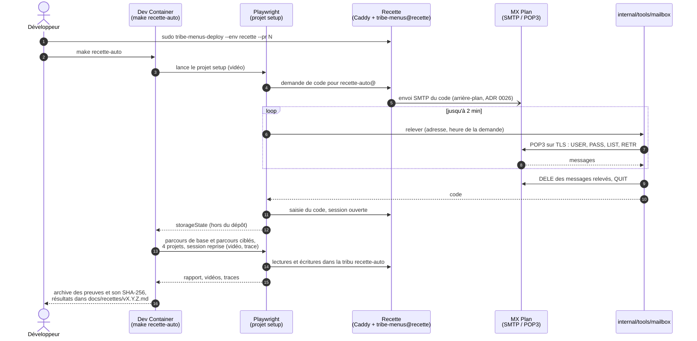

# 0032. Recette en partie automatisée : plan de recette par analyse des risques, parcours filmés sur la recette

- **Date** : 2026-11-14
- **Statut** : proposé (plan `recette-auto`), accepté à la fusion de la PR du plan

## Contexte

Avant chaque release, le développeur déploie l'archive de la PR de release en recette et y vérifie, guidé pas à pas, les stories de la version et les scénarios `@manuel` (ADR 0005, point 4 ; ADR 0016 ; `RELEASING.md`, étape 6). La séance couvre trois appareils et grandit à chaque plan. Une partie de ce qu'on y vérifie n'a besoin ni d'un vrai appareil ni d'un œil humain : la version déployée répond, la migration est passée sur des données existantes, le code arrive par e-mail et connecte, chaque onglet lit et écrit derrière Caddy. Le reste en a besoin : toucher, clavier virtuel, rotation physique, rendu, réception sur les vraies messageries.

La CI prouve déjà les règles contre l'API (godog) et l'interface sur un serveur de test (Playwright, scénarios `@ui`, `make e2e-formats` sur la PR de release). Elle ne voit ni le serveur réel (systemd, Caddy, TLS, cookies `__Host-`, empreintes du front servies avec `immutable`), ni l'envoi SMTP réel, ni une migration appliquée à des données accumulées.

On veut :

- décider, **pour chaque release**, ce qui se prouve automatiquement et ce qui reste manuel, à partir des changements et de leurs risques, plutôt que de rejouer une check-list qui grossit ;
- jouer la partie automatique contre l'instance de recette, depuis le Dev Container, avec une **preuve** (vidéo, trace) de ce qui a été vu ;
- lire le code de connexion envoyé par e-mail sans porte dérobée sur une instance publique.

Le Dev Container n'a ni adresse publique ni port 25 : il ne peut pas recevoir de courrier, seulement en relever. La bibliothèque standard de Go n'a pas de client IMAP ; le protocole POP3, lui, tient en quelques commandes texte. La limitation des demandes de code (ENF-01, ADR 0021 : 3 par quart d'heure pour une adresse, 10 par heure pour une IP) et le quota du MX Plan (ADR 0014) bornent le nombre de connexions par exécution.

## Décision

1. **Toute recette commence par une analyse des changements et des risques**, qui produit le **plan de recette** de la version : `docs/recettes/vX.Y.Z.md`, d'après un gabarit, ajouté à la PR de release avant le déploiement en recette. La session qui prépare la PR de release le propose ; le développeur le valide ou le corrige avant la séance. La procédure est dans `docs/recette.md`.
2. **Inventaire** : une entrée par ligne de la section `## Non publié` de `CHANGELOG.md` (une par PR), complétée par ce que les lignes ne disent pas : migrations, `deploy/`, dépendances (`go.mod`, `web/package-lock.json`), version de Go ou de Node.
3. **Trois questions par changement** :
   - **gravité** si le défaut passe en production : *haute* (données perdues ou faussées, une tribu qui voit une autre, connexion impossible, sécurité), *moyenne* (une fonction inutilisable, contournement possible), *faible* (gêne, affichage) ;
   - **probabilité qu'un défaut ait échappé à la CI** : *élevée* (code nouveau sans scénario passé, calcul, migration, comportement que seul un navigateur réel exerce, scénarios encore en attente, écran prouvé seulement sur l'API simulée), *moyenne*, *faible* (scénarios godog ou `@ui` passés dans tous les formats, changement mécanique) ;
   - **dépendance à l'environnement réel** : migration sur des données existantes ; Caddy, TLS, en-têtes, cookies ; envoi SMTP ; systemd et provisionnement ; cache et empreintes du front ; vrai appareil (toucher, clavier virtuel, rotation, application installée) ; jugement visuel ; vraies messageries ; Safari réel.
4. **Voie de preuve**, déduite des trois réponses ; un changement peut en avoir plusieurs :
   - **CI** : risque faible (gravité et probabilité faibles ou moyennes) sans dépendance à l'environnement. Rien de plus en recette que les parcours de base (point 5) ;
   - **automatique sur la recette** : dépendance au serveur, à l'envoi ou au cache, ou risque moyen ou élevé qu'un écran émulé suffit à voir. Le plan de recette nomme le parcours qui le couvre, ou en demande un ;
   - **manuel** : ce que l'émulation ne prouve pas (vrai appareil, jugement visuel, vraies messageries), les scénarios `@manuel`, et tout changement de gravité haute et de probabilité élevée, même couvert par un parcours automatique.
5. **Parcours de base**, joués à chaque recette quoi qu'en dise l'analyse : connexion par code reçu par e-mail ; chaque onglet s'ouvre ; une écriture relue par onglet (un plat, un plat servi, un article coché) ; rechargement sur une version nouvelle.
6. **Les parcours de recette sont des tests Playwright ordinaires**, dans `web/recette/`, avec leur configuration (`web/playwright.recette.config.ts`), pas des `.feature` : ils ne sont pas des critères d'acceptation (ADR 0005, point 1, inchangé) mais la preuve qu'une version déployée tient. Ils créent leurs données par l'interface : `e2efixture` écrit dans des bases locales et n'a pas cours sur une instance distante.
7. **Une tribu dédiée sur l'instance de recette**, `recette-auto`, dont l'unique membre est `recette-auto@codingmatters.org`, une **vraie boîte du MX Plan**, pas une redirection, qui ne reçoit que les codes de cette tribu. Elle n'est jamais membre en production. Les données d'une exécution portent un suffixe d'exécution et s'accumulent (un plat ne se supprime pas) ; la tribu se recrée quand elle gêne.
8. **Le code est relevé en POP3** par un outil Go du projet (`internal/tools/mailbox`), sur la bibliothèque standard (`crypto/tls`, `net/textproto`) : connexion TLS au MX Plan, message le plus récent adressé à l'adresse et arrivé après l'heure de la demande, code imprimé sur la sortie standard, messages relevés supprimés. Les parcours l'appellent comme un programme. Le mot de passe de la boîte est dans un fichier hors du dépôt, dans le Dev Container ; jamais dans la CI.
9. **Une seule demande de code par exécution** : un projet Playwright `setup`, filmé, se connecte et enregistre l'état de la session (`storageState`) hors du dépôt ; les autres projets le reprennent. L'exécution se lance avant la séance manuelle, qui part souvent de la même IP.
10. **Quatre projets** repris de `web/playwright.config.ts` : `phone-chromium`, `phone-webkit`, `tablet-landscape-chromium`, `computer-chromium`. Vidéo, trace et captures toujours enregistrées ; rapport HTML.
11. **Les preuves restent hors de GitHub** : résultats dans `web/recette-results/` (ignoré par Git), réunis en une archive `recette-vX.Y.Z-<horodatage>.tar.gz` avec son empreinte SHA-256, gardée par le développeur. Le plan de recette consigne la date, l'archive de PR déployée, le résultat de chaque parcours et l'empreinte des preuves.
12. **Lancement par `make recette-auto`** depuis le Dev Container, après `tribe-menus-deploy --env recette --pr <numéro>` ; Claude Code peut le lancer et reporter le résultat dans le plan de recette, et un résumé sur la PR. Pas de workflow GitHub : la CI n'a pas le mot de passe de la boîte et ne doit pas l'avoir (dépôt public, workflows sur PR).
13. **Version corrective d'une vulnérabilité** (ADR 0022) : au niveau normal, comme une release ordinaire. Aux niveaux accéléré et urgent, l'analyse reste dans la conversation, hors de GitHub, et seul un plan de recette en termes neutres entre dans la PR, après la production.

### Déroulé d'une exécution

## Alternatives envisagées

- **Rejouer les scénarios `@ui` contre la recette** : écarté. Leurs étapes « Soit » écrivent directement dans les bases par `e2efixture`, et la CI les a déjà prouvés ; ce qui manque est l'environnement, pas les règles.
- **Une route de préparation des données, ou qui renverrait le dernier code, sur la recette** : écarté. Porte dérobée sur une instance joignable publiquement.
- **Injecter un cookie de session au lieu de se connecter** : écarté. La connexion par e-mail est justement ce que la CI ne voit pas.
- **IMAP** (`imapflow` en npm, `go-imap` en Go) : écarté. Une dépendance pour un besoin que POP3 couvre avec la bibliothèque standard.
- **Mailpit dans le Dev Container** : écarté pour la recette, qui envoie par le MX Plan ; possible plus tard pour éprouver `SMTPMailer` en local.
- **Une boîte Gmail dédiée** : écarté pour l'automatique. Ajoute un compte tiers ; la réception sur les vraies messageries reste une vérification manuelle, ponctuelle (ADR 0014, point 6).
- **Les parcours dans un workflow GitHub** : écarté (point 12).
- **Les vidéos en artefact de CI ou dans la PR** : écarté. Elles montrent l'identifiant de la tribu de recette dans les URL et pèsent lourd ; une empreinte suffit à les lier au plan de recette.
- **Une check-list fixe qui s'allonge à chaque plan** : c'est l'état actuel. Écarté au profit de l'analyse, qui garde la séance manuelle courte et la justifie.

## Conséquences

- **Positif** : chaque séance de recette a un plan argumenté, relu avant d'être joué ; la séance manuelle se réduit à ce qui demande un appareil ou un œil ; l'environnement réel (serveur, envoi, migration) est éprouvé à chaque release, avec des preuves datées ; aucune dépendance nouvelle.
- **Négatif** : un outil POP3 et des parcours à maintenir, cassés par des changements d'écran comme les tests d'écran ; une boîte, une tribu et un secret de plus à gérer ; l'analyse ajoute un temps de rédaction à chaque release ; la tribu `recette-auto` s'emplit.
- **Risques acceptés** : le mot de passe de la boîte est lisible dans le Dev Container, donc par Claude Code ; il ne donne accès qu'à la tribu `recette-auto` de la recette, qui n'a que des données de test. La relève dépend de la disponibilité du POP3 du MX Plan.
- **Précise** l'ADR 0005 (point 4 : ce qui est vérifié en recette) et l'ADR 0016 (déroulé de la recette) ; `RELEASING.md`, étape 6, renvoie à `docs/recette.md`.
