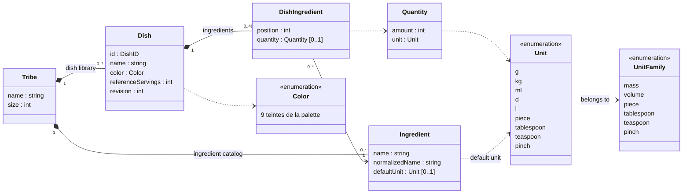
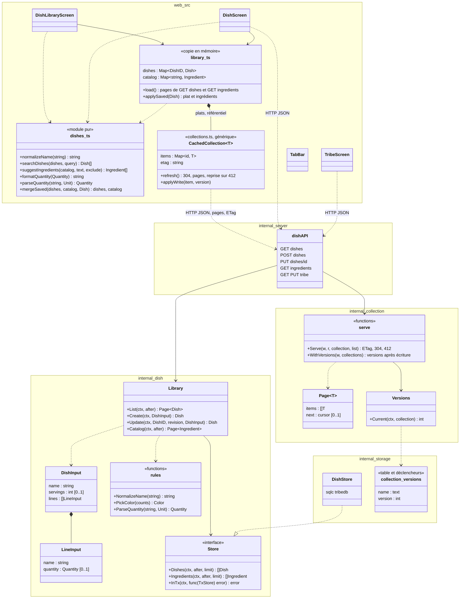
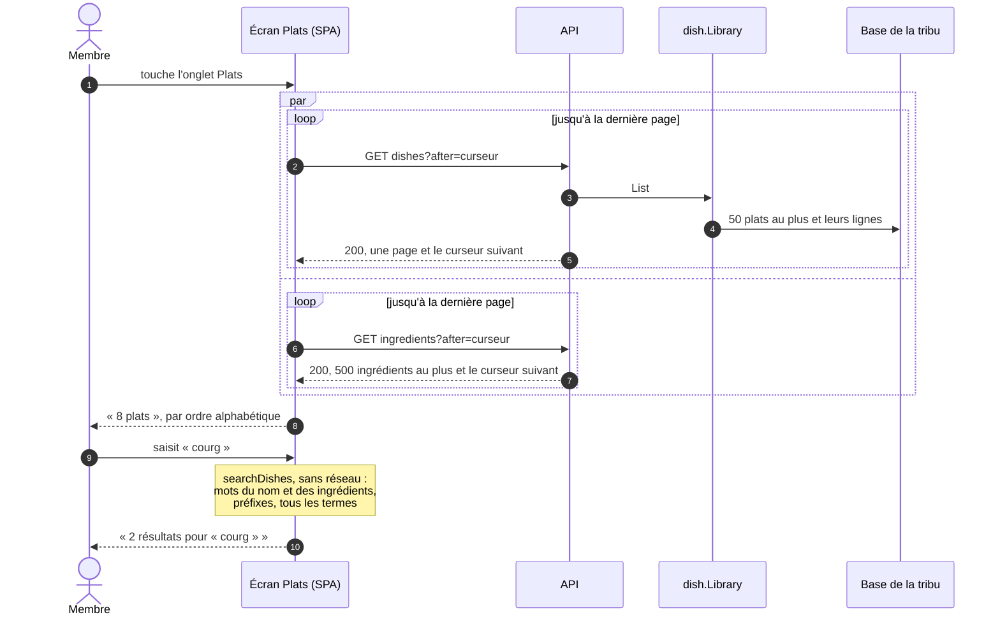
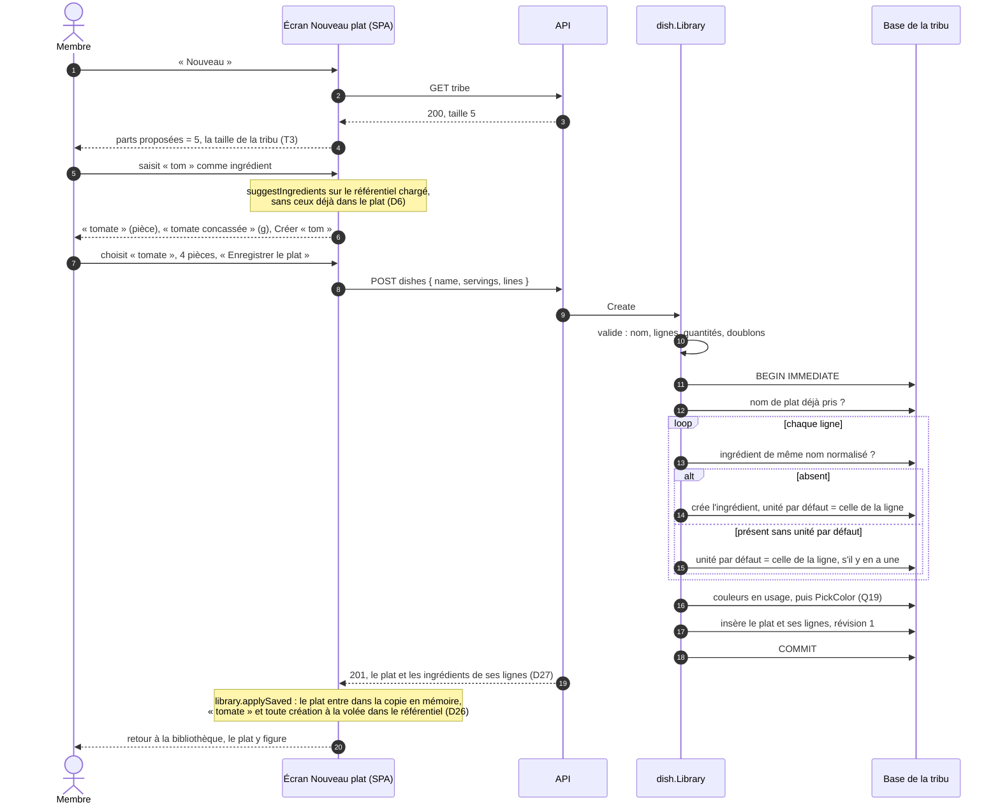
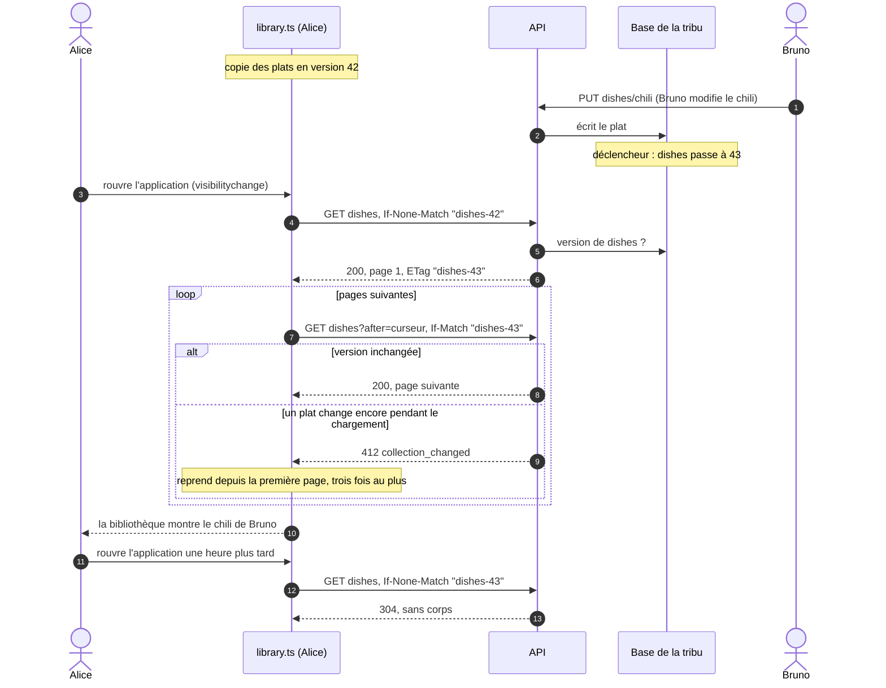
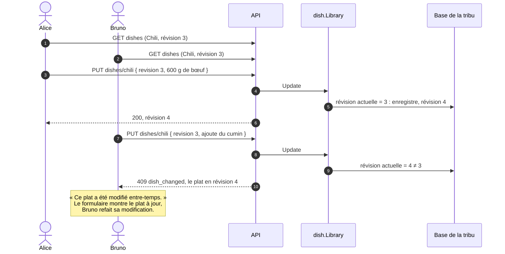
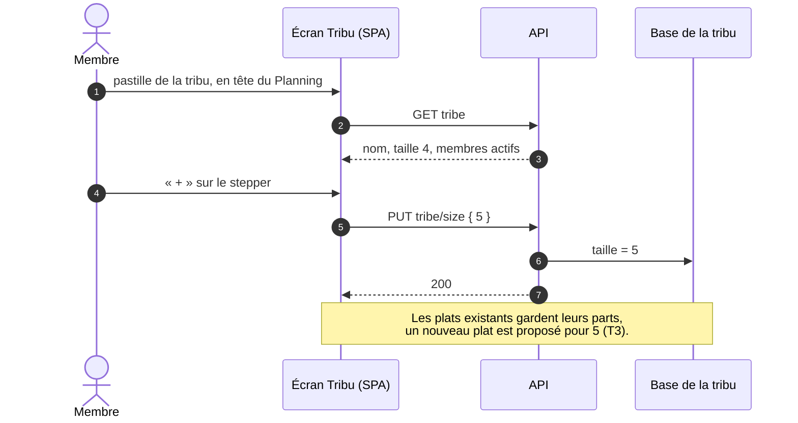

# Conception : bibliothèque de plats

- **Mise à jour** : 2026-10-29
- **Statut** : retenu avec le plan [`bibliotheque`](../plans/2026-10-29-bibliotheque-de-plats.md), prêt depuis le 2026-10-29 ; à tenir à jour pendant ses lots
- **Stories** : P1 à P4, T1 à T3 ; ENF-02 pour les plats et le référentiel

Ce document décrit la conception retenue pour la bibliothèque de plats, le référentiel d'ingrédients et la taille de la tribu : modèle, découpage du code, échanges. Il est tenu à jour par les plans qui touchent ce domaine (planning, listes de courses, hors-ligne) ; un plan, lui, se fige une fois terminé. Les règles fonctionnelles sont dans `docs/specs/fonctionnalites.md`, les décisions dans les ADR et dans les plans ; ce document les cite sans les répéter.

Noms anglais du code selon `docs/specs/glossaire.md` ; les termes marqués « nouveau » y sont ajoutés par le lot A du plan.

## Modèle du domaine

- **Tribe** : la ligne unique de la base de la tribu (ADR 0003) gagne sa **taille** (T3), 4 par défaut, de 1 à 50 (plan, D12). Elle propose les parts d'un nouveau plat, puis, avec le planning, celles d'un plat servi.
- **Dish** : identifiant aléatoire (D10), nom unique dans la tribu au sens du nom normalisé (D7), couleur attribuée à la création et jamais changée (Q19), parts de référence, **révision** (nouveau terme : *revision*), augmentée à chaque modification, qui fait refuser un enregistrement fait sur une version dépassée (D5).
- **DishIngredient** : une ligne par ingrédient dans un plat (D6), dans l'ordre de saisie ; quantité **facultative** (D4) : sans quantité, pas d'unité.
- **Ingredient** : nom affiché de la première saisie, nom normalisé unique dans la tribu, unité par défaut = première unité saisie avec lui, absente tant qu'aucune ligne n'en a eu (Q20, D4). Créé seulement en saisissant un plat, ici, ou un article ajouté, au plan des listes.
- **Quantity** : un entier dans l'unité de base de la famille (milligramme, millilitre, millième de pièce, de cuillère ou de pincée ; ADR 0003, point 7) et l'unité choisie pour la ligne, qui sert à l'afficher comme elle a été saisie. Une saisie n'a que les décimales que l'unité de base représente : aucune en ml, une en cl, trois dans les autres unités ; au-delà, elle est refusée (plan, D20).
- **Pas de suppression** de plat (Q5b) ni d'ingrédient (pas d'écran du référentiel en V1).

### Nom normalisé

Une seule règle, pour les noms d'ingrédients (Q20), les noms de plats (D7), la recherche (P3) et l'autocomplétion (P4) :

1. minuscules, d'abord, pour que les étapes suivantes n'aient à connaître que des minuscules (« Œufs » devient « œufs ») ;
2. ligatures dépliées : œ → oe, æ → ae (D8, au-delà de Q20 : sans cela, « boeuf » ne trouve pas « bœuf ») ;
3. décomposition Unicode (NFD), puis retrait des seuls signes diacritiques combinants U+0300 à U+036F, comme la maquette `Doux-Bibliotheque` : le même ensemble en Go et en TypeScript, et non la catégorie Unicode `Mn` entière ;
4. apostrophes ramenées à `'` (U+0027) : ’ (U+2019), que la ponctuation intelligente de l'iPhone saisit par défaut, ‘ (U+2018) et ʼ (U+02BC) ;
5. espaces : l'espace insécable (U+00A0) et l'espace fine insécable (U+202F) comptent comme des espaces ; espaces en tête et en fin retirés, suites d'espaces réduites à une espace ordinaire.

La table de cas commune (D9) contient au moins « Œufs brouillés », « oeufs brouillés » et « œufs brouillés », qui donnent le même nom normalisé, des lettres accentuées en majuscule (« Éclair », « ÉPINARDS »), « piment d’Espelette » et « piment d'Espelette », et un nom avec une espace insécable.

Ces règles fixent l'identité d'un ingrédient et l'unicité d'un nom de plat, que les index uniques de la migration `0007` figent : les corriger après coup demanderait de fusionner des données.

Elle existe deux fois : en Go, qui décide de l'identité d'un ingrédient et de l'unicité d'un nom de plat, et en TypeScript, qui cherche et propose. La décomposition Unicode se fait par `golang.org/x/text/unicode/norm` en Go, seule dépendance d'exécution nouvelle, et par `String.prototype.normalize` dans le navigateur. Une table de cas commune, lue par `go test` et `node:test`, les garde d'accord (D9).

Pour la recherche et l'autocomplétion, le nom normalisé est découpé en **mots** sur tout caractère hors `a-z` et `0-9` ; un terme recherché trouve un mot qui **commence** par lui, et tous les termes doivent être trouvés (P3, comme la maquette `Doux-Bibliotheque`).

## Découpage du code

- **`internal/dish`** (nouveau paquet, ADR 0008 : un paquet par domaine) : la logique pure (règles, validation, choix de la couleur, résolution des ingrédients) derrière une interface `Store` ; aucune trace de HTTP ni de SQL (ADR 0002). Le paquet des listes de courses s'en servira pour le référentiel.
- **`internal/collection`** (nouveau, générique, ADR 0029) : versions des collections, pages, ETag et réponses conditionnelles, versions jointes aux écritures ; toute route de collection de l'API passe par lui (plan, D28).
- **`internal/storage`** : migration `0007` de la base de la tribu (avec `collection_versions` et ses déclencheurs), requêtes sqlc, adaptateur `DishStore`.
- **`internal/tribe`** : la taille de la tribu, avec le nom.
- **`internal/server`** : routes minces sous `/tribes/<slug>/api/`, derrière la session (ADR 0001, 0003).
- **`web/src`** : `collections.ts`, copie générique d'une collection, dont la décision (garder, recharger, reprendre) est une fonction pure (plan, D29) ; `dishes.ts`, module pur testé par `node:test` (ADR 0005, point 3) ; écrans en DOM classique, stepper de parts en shadow DOM avec `ElementInternals` (ADR 0004, point 3).

Les noms des méthodes sont indicatifs : le lot B les fixe.

## API

| Route | Corps | Réponses |
| --- | --- | --- |
| `GET dishes?after=…` | | 200 : une page de 50 plats au plus, avec leurs lignes, dans l'ordre des identifiants, et le curseur de la page suivante, absent à la dernière (D2) |
| `POST dishes` | nom, parts (facultatives : taille de la tribu), lignes `{ name, quantity?, unit? }` | 201 : le plat, chaque ligne portant le nom affiché et l'unité par défaut de son ingrédient (D27) ; 400 : `name_required`, `name_taken`, `invalid_line`… |
| `PUT dishes/{id}` | révision lue, nom, parts, lignes | 200 : le plat, comme pour `POST` ; 409 `dish_changed` avec le plat à jour (D5) ; 404 comme un identifiant inconnu (ENF-02) |
| `DELETE dishes/{id}` | | 405 : la route n'existe pas (P2, ADR 0005, point 4) |
| `GET ingredients?after=…` | | 200 : une page de 500 ingrédients au plus, nom et unité par défaut, et le curseur de la page suivante (D2) |
| `GET tribe` | | 200 : nom, taille, nombre de membres actifs |
| `PUT tribe/size` | taille | 200 ; 400 hors de 1 à 50 |

Une ligne désigne son ingrédient **par son nom** : le serveur le rapproche d'un ingrédient existant de même nom normalisé, ou le crée (Q20). C'est déjà le mode prévu pour un article ajouté hors ligne (ADR 0004, point 7).

### Versions des collections

Mécanisme générique, pour toutes les collections de l'API (plan, D28 ; ADR 0029) :

| Échange | Requête | Réponse |
| --- | --- | --- |
| Premier chargement | `GET dishes` | 200, première page, `ETag: "dishes-42"` |
| Pages suivantes | `GET dishes?after=…`, `If-Match: "dishes-42"` | 200, page suivante ; `412 collection_changed` si la version a changé entre-temps |
| Vérification | `GET dishes`, `If-None-Match: "dishes-42"` | `304` sans corps si rien n'a changé ; sinon 200, première page, nouvel ETag |
| Écriture | `POST dishes`, `PUT dishes/{id}` | le plat, et `versions` : `{ "dishes": 43, "ingredients": 18 }` |

La version d'une collection est un entier de la table `collection_versions`, augmenté par des déclencheurs SQLite sur chacune de ses tables : `dishes` pour les tables `dishes` et `dish_ingredients`, `ingredients` pour la table `ingredients`. Aucune écriture ne peut oublier de l'augmenter.

## Données dans le navigateur

Plats et référentiel vivent dans une **copie en mémoire** (`web/src/library.ts`), partagée par la bibliothèque et l'écran d'un plat (plan, D25), et faite de deux copies génériques de collection (`collections.ts`, D29). Elle est vérifiée à chaque visite de l'onglet Plats et à chaque retour de l'application au premier plan, et rechargée par pages seulement si la collection a changé (D2, D29), mise à jour par la réponse d'un enregistrement ou d'un refus `409` (D26), qui porte aussi les ingrédients de ses lignes, fusionnés dans le référentiel (D27). Rien n'est écrit sur l'appareil : la copie disparaît au rechargement, à la déconnexion et sur un 401. Le stockage hors ligne (cache du service worker ou IndexedDB) reste à choisir au plan hors-ligne.

## Échanges

### Ouvrir l'onglet Plats et chercher

Chaque réponse est bornée (D2), mais l'écran garde tout : la recherche ne coûte ensuite aucune requête, et fonctionnera hors ligne quand le plan hors-ligne mettra ces pages en cache (ADR 0004, point 7 ; PT-04).

### Créer un plat

Tout se fait dans une transaction d'écriture (`BEGIN IMMEDIATE`, ADR 0003) : deux membres qui créent en même temps « tomate » ou un plat du même nom ne font ni doublon ni couleur choisie sur un état périmé ; le second reçoit `name_taken` pour le nom.

### Revenir sur l'application après une modification d'un autre membre

Sans changement, une vérification coûte une requête et un `304` : elle se fait à chaque retour, sans seuil de temps.

### Modifier un plat que quelqu'un vient de modifier

### Régler la taille de la tribu

## Ce que ce document ne couvre pas encore

- Le plat servi et le planning (R1 à R5), qui ajouteront au modèle le repas et le plat servi.
- Les listes de courses : article sans quantité issu d'une ligne sans quantité (plan, questions ouvertes).
- Le delta d'une collection (`?since=<version>`), qui éviterait de tout recharger pour une seule modification : au plan hors-ligne.
- Le hors-ligne : stockage des plats et du référentiel sur l'appareil, cache du service worker ou IndexedDB, à choisir avec la pagination (plan, questions ouvertes) ; effacement à la déconnexion.
