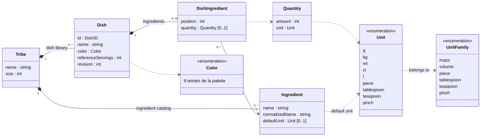
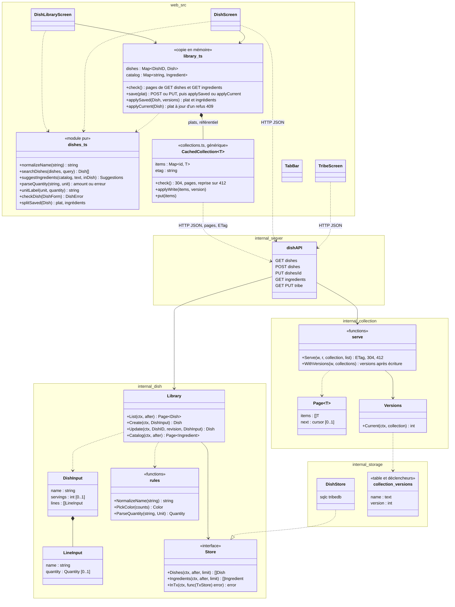
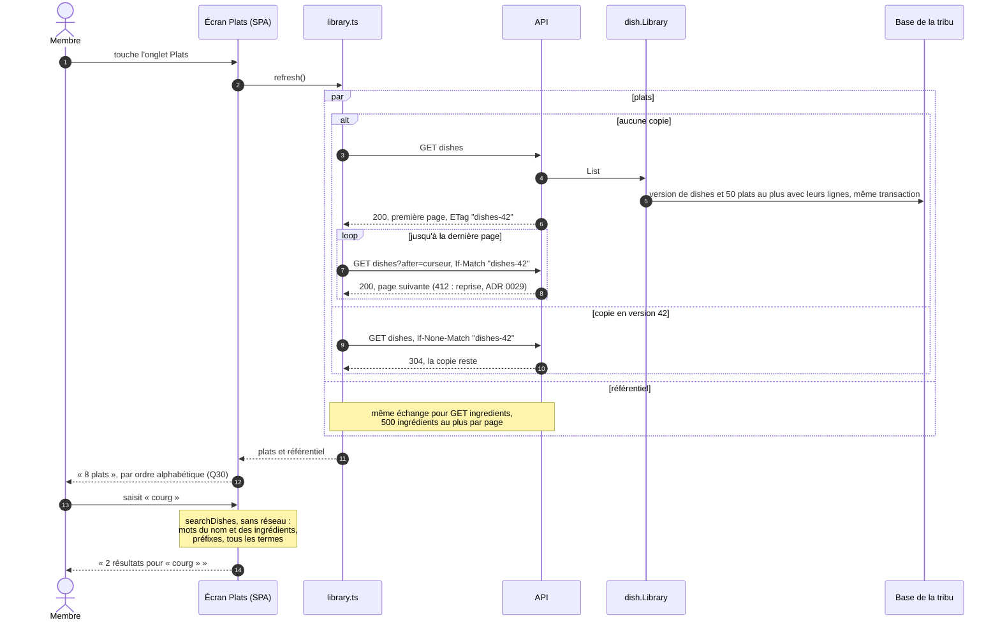
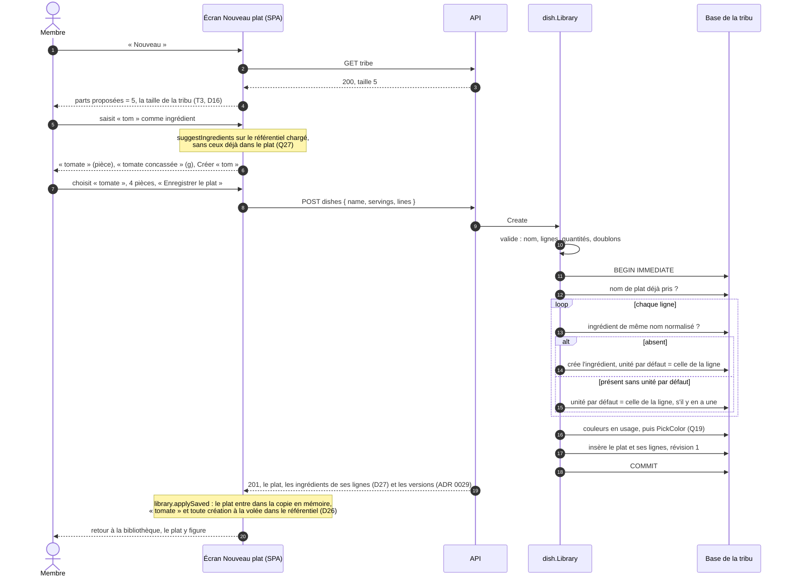
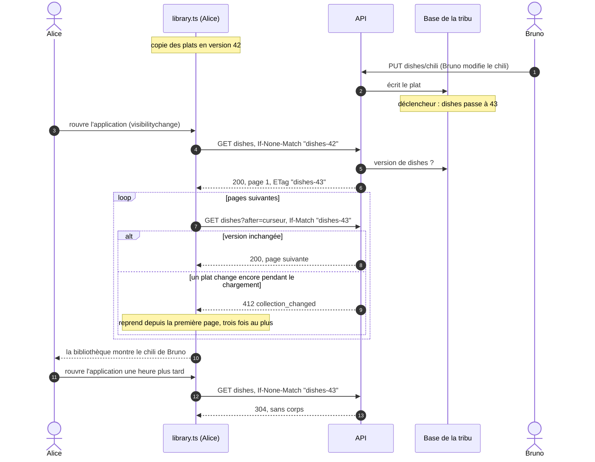
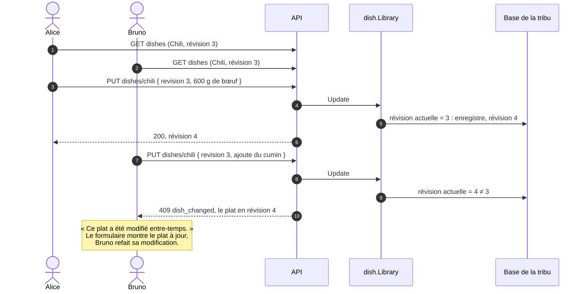
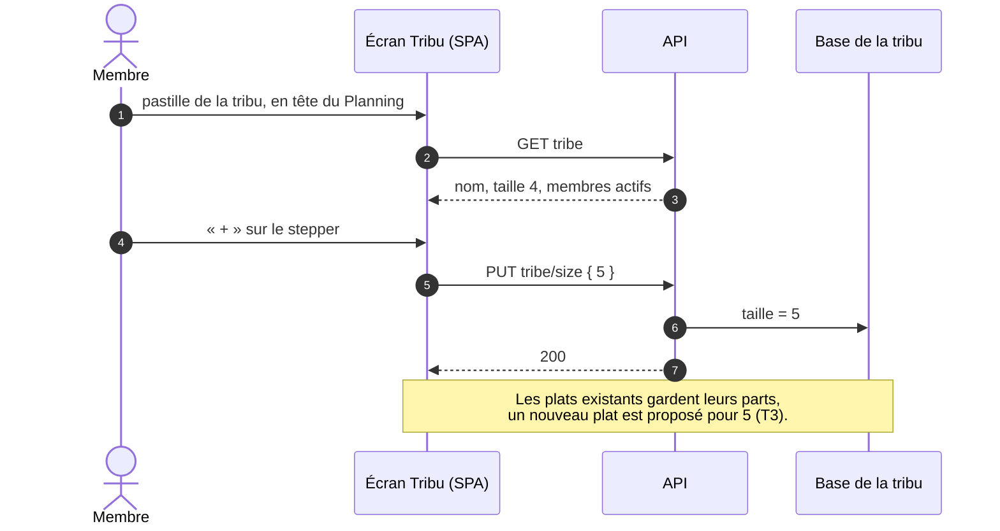

# Conception : bibliothèque de plats

- **Mise à jour** : 2026-11-05
- **Statut** : retenu avec le plan [`bibliotheque`](../plans/2026-10-29-bibliotheque-de-plats.md), prêt depuis le 2026-10-29, accordé aux specs, au glossaire et aux ADR 0027 à 0029 par le lot A (2026-11-03), API et noms du code fixés par le lot B (2026-11-03), noms du navigateur par le lot D (2026-11-03) ; en production avec `v0.2.0` (2026-11-05), à tenir à jour par les plans qui touchent ce domaine
- **Stories** : P1 à P4, T1 à T3 ; ENF-02 pour les plats et le référentiel

Ce document décrit la conception retenue pour la bibliothèque de plats, le référentiel d'ingrédients et la taille de la tribu : modèle, découpage du code, échanges. Il est tenu à jour par les plans qui touchent ce domaine (planning, listes de courses, hors-ligne) ; un plan, lui, se fige une fois terminé. Les règles fonctionnelles sont dans `docs/specs/fonctionnalites.md` (P1 à P4, T3, Q19, Q20, Q25 à Q31), les décisions dans les ADR (0027 recherche et autocomplétion dans le navigateur, 0028 scénarios `@ui`, 0029 versions et ETag des collections) et dans les plans ; ce document les cite sans les répéter.

Noms anglais du code selon `docs/specs/glossaire.md`, qui contient depuis le lot A les termes de ce document : révision (*revision*), ligne d'ingrédient (*dish ingredient*), nom normalisé (*normalized name*), recherche (*search*), proposition (*suggestion*), collection, version d'une collection (*collection version*), copie d'une collection (*cached collection*), barre d'onglets (*tab bar*).

## Modèle du domaine

- **Tribe** : la ligne unique de la base de la tribu (ADR 0003) gagne sa **taille** (T3), 4 par défaut, de 1 à 50 (plan, D12). Elle propose les parts d'un nouveau plat, puis, avec le planning, celles d'un plat servi.
- **Dish** : identifiant aléatoire (D10), nom unique dans la tribu au sens du nom normalisé (D7), couleur attribuée à la création et jamais changée (Q19), parts de référence, **révision**, augmentée à chaque modification, qui fait refuser un enregistrement fait sur une version dépassée (Q25, D5).
- **DishIngredient** : une ligne par ingrédient dans un plat (Q27, D6), dans l'ordre de saisie ; quantité **facultative** (Q26, D4) : sans quantité, pas d'unité.
- **Ingredient** : nom affiché de la première saisie, nom normalisé unique dans la tribu, unité par défaut = première unité saisie avec lui, absente tant qu'aucune ligne n'en a eu (Q20, D4). Créé seulement en saisissant un plat, ici, ou un article ajouté, au plan des listes.
- **Quantity** : un entier dans l'unité de base de la famille (milligramme, millilitre, millième de pièce, de cuillère ou de pincée ; ADR 0003, point 7) et l'unité choisie pour la ligne, qui sert à l'afficher comme elle a été saisie. Une saisie n'a que les décimales que l'unité de base représente : aucune en ml, une en cl, trois dans les autres unités ; au-delà, elle est refusée (Q31, D20). Affichage : virgule décimale, pluriel à partir de 2, cuillères abrégées (`docs/design/README.md`, « Affichage des quantités »).
- **Pas de suppression** de plat (Q5b) ni d'ingrédient (pas d'écran du référentiel en V1).

### Nom normalisé

Une seule règle (Q29, ADR 0027), pour les noms d'ingrédients (Q20), les noms de plats (Q28), la recherche (P3) et l'autocomplétion (P4) :

1. minuscules, d'abord, pour que les étapes suivantes n'aient à connaître que des minuscules (« Œufs » devient « œufs ») ;
2. ligatures dépliées : œ → oe, æ → ae (D8, au-delà de Q20 : sans cela, « boeuf » ne trouve pas « bœuf ») ;
3. décomposition Unicode (NFD), puis retrait des seuls signes diacritiques combinants U+0300 à U+036F, comme la maquette `Doux-Bibliotheque` : le même ensemble en Go et en TypeScript, et non la catégorie Unicode `Mn` entière ;
4. apostrophes ramenées à `'` (U+0027) : ’ (U+2019), que la ponctuation intelligente de l'iPhone saisit par défaut, ‘ (U+2018) et ʼ (U+02BC) ;
5. espaces : l'espace insécable (U+00A0) et l'espace fine insécable (U+202F) comptent comme des espaces ; espaces en tête et en fin retirés, suites d'espaces réduites à une espace ordinaire.

La table de cas commune (D9) contient au moins « Œufs brouillés », « oeufs brouillés » et « œufs brouillés », qui donnent le même nom normalisé, des lettres accentuées en majuscule (« Éclair », « ÉPINARDS »), « piment d’Espelette » et « piment d'Espelette », et un nom avec une espace insécable.

Ces règles fixent l'identité d'un ingrédient et l'unicité d'un nom de plat, que les index uniques de la migration `0007` figent : les corriger après coup demanderait de fusionner des données.

Les espaces de l'étape 5 sont un ensemble fixé, le même dans les deux langages : les espaces ASCII (espace, tabulation, saut de ligne, retour chariot, saut de page, tabulation verticale), U+00A0 et U+202F, et aucun autre ; ni `unicode.IsSpace` en Go ni `\s` en JavaScript, qui ne retiennent pas les mêmes caractères (lot B).

**Nom affiché** (D30, étape 21 bis du plan) : le nom saisi, espaces réduites comme à l'étape 5 mais sans les autres étapes (casse, accents et apostrophes gardés). Un caractère de contrôle (`Cc`) hors de ces espaces le fait refuser (`name_invalid`, `ingredient_name_invalid`) ; un nom sans caractère visible (catégories `L`, `N`, `P`, `S`) est refusé comme un nom vide. Règle du serveur seul : le navigateur reçoit le nom affiché dans le plat renvoyé.

Elle existe deux fois : en Go, qui décide de l'identité d'un ingrédient et de l'unicité d'un nom de plat, et en TypeScript, qui cherche et propose. La décomposition Unicode se fait par `golang.org/x/text/unicode/norm` en Go, seule dépendance d'exécution nouvelle, et par `String.prototype.normalize` dans le navigateur. Une table de cas commune, le fichier `internal/dish/testdata/normalized-names.json`, lu par `go test` et par `node:test`, les garde d'accord (D9).

Pour la recherche et l'autocomplétion (Q30), le nom normalisé est découpé en **mots** sur tout caractère hors `a-z` et `0-9` ; un terme recherché trouve un mot qui **commence** par lui, et tous les termes doivent être trouvés (P3, comme la maquette `Doux-Bibliotheque`).

## Découpage du code

- **`internal/dish`** (nouveau paquet, ADR 0008 : un paquet par domaine) : la logique pure (règles, validation, choix de la couleur, résolution des ingrédients) derrière une interface `Store` ; aucune trace de HTTP ni de SQL (ADR 0002). Le paquet des listes de courses s'en servira pour le référentiel.
- **`internal/collection`** (nouveau, générique, ADR 0029) : versions des collections, pages, ETag et réponses conditionnelles, versions jointes aux écritures ; toute route de collection de l'API passe par lui (plan, D28).
- **`internal/storage`** : migration `0007` de la base de la tribu (avec `collection_versions` et ses déclencheurs), requêtes sqlc, adaptateur `DishStore`.
- **`internal/tribe`** : la taille de la tribu, avec le nom.
- **`internal/server`** : routes minces sous `/tribes/<slug>/api/`, derrière la session (ADR 0001, 0003).
- **`web/src`** : `collections.ts`, copie générique d'une collection, dont la décision (garder, recharger, reprendre) est une fonction pure (plan, D29) ; `dishes.ts`, module pur testé par `node:test` (ADR 0005, point 3) ; écrans en DOM classique, stepper de parts en shadow DOM avec `ElementInternals` (ADR 0004, point 3).

Noms fixés au lot B :

- **`internal/dish`** : règles (`NormalizeName`, `ParseUnit`, `ParseQuantity`, `Quantity.Text`, `PickColor`, `Palette`), validation d'un `Input` (codes `ErrorCode`, erreur `InputError` avec la ligne en cause), `Library` (`Dishes`, `Catalog`, `Version`, `Create`, `Update`) derrière les interfaces `Store` (lectures par pages, `Write`) et `Tx` (lectures et écritures d'une transaction d'écriture) ; erreurs `ErrNotFound` et `ChangedError` (le plat à jour).
- **`internal/collection`** : `Versions`, `Page[T]`, `Source[T]` (version, puis page et version dans une même transaction), `Serve`, `ETag`, `ErrBadCursor`.
- **`internal/storage`** : `DishStore`, adaptateur de `dish.Store`, et la déclaration `Collections` (nom d'une collection et ses tables), que lit le test de schéma. L'adaptateur est dans `internal/storage`, comme le prévoit le plan, alors que celui des membres et des sessions (`tribe.Store`) est dans `internal/tribe`.
- **`internal/tribe`** : `Store.Size`, `Store.SetSize`, `Store.ActiveMembers`.

Noms fixés au lot D, dans `web/src` :

- **`dishes.ts`** : `suggestIngredients` (propositions et « Créer « … » »), `highlight` (débuts de mots trouvés), `units`, `parseQuantity` (sur la table de cas `internal/dish/testdata/quantities.json`, commune avec `ParseQuantity`), `unitLabel`, `quantityInput`, `checkDish` et `dishErrorMessage` (contrôle avant l'envoi et messages), `splitSaved` (plat renvoyé et ingrédients de ses lignes, D27).
- **`library.ts`** : `Library.save`, `applySaved`, `applyCurrent` ; **`collections.ts`** : `applyWrite` prend les éléments d'une écriture, `put` des éléments sans version (plat à jour d'un refus `409`).
- **Écrans** : `dish-screen.ts` (`mt-dish-screen`, création et modification), `tribe-screen.ts` (`mt-tribe-screen`), `stepper.ts` (`mt-stepper`, shadow DOM et `ElementInternals`) ; `api.ts` : `saveDish`, `setTribeSize`.

## API

| Route | Corps | Réponses |
| --- | --- | --- |
| `GET dishes?after=…` | | 200 : `{ items, next? }`, une page de 50 plats au plus, avec leurs lignes, dans l'ordre des identifiants, et le curseur de la page suivante, absent à la dernière (D2) |
| `POST dishes` | `{ name, servings?, ingredients: [{ name, quantity?, unit? }] }` | 201 : `{ dish, versions }`, le plat, chaque ligne portant le nom affiché et l'unité par défaut de son ingrédient (D27), et les versions des collections (ADR 0029) ; 400 : `{ error, line?, ingredient? }` |
| `PUT dishes/{id}` | `{ revision, name, servings, ingredients }` | 200 : comme pour `POST` ; 400 comme pour `POST`, et `bad_request` sans révision ; 409 `{ error: "dish_changed", dish }`, le plat à jour (Q25, D5) ; 404 `not_found` pour un identifiant inconnu comme pour celui d'une autre tribu (ENF-02) |
| `DELETE dishes/{id}` | | 405 : la route n'existe pas (P2, ADR 0005, point 4) ; `GET dishes/{id}` non plus : 404 de toute route `GET` inconnue |
| `GET ingredients?after=…` | | 200 : `{ items: [{ name, defaultUnit? }], next? }`, une page de 500 ingrédients au plus (D2) ; 400 `bad_request` pour un curseur illisible |
| `GET tribe` | | 200 : `{ name, size, activeMembers }` |
| `PUT tribe/size` | `{ size }` | 200 : comme `GET tribe` ; 400 `invalid_size` hors de 1 à 50 |

Toutes ces routes répondent 401 `no_session` sans session, pour une tribu existante comme pour une autre, et gardent `Cache-Control: no-store`. Corps limité à 16 Kio pour un plat, 4 Kio ailleurs (D20).

- **Une ligne désigne son ingrédient par son nom** : le serveur le rapproche d'un ingrédient existant de même nom normalisé, ou le crée (Q20). C'est déjà le mode prévu pour un article ajouté hors ligne (ADR 0004, point 7).
- **Quantité** : le texte saisi, une chaîne JSON (« 2,5 » ou « 2.5 »), lue et contrôlée par le serveur (Q31) ; il la rend dans l'unité de la ligne, avec un point et sans zéro inutile (« 0.125 ») : `dishes.ts` l'affiche avec une virgule. Un nombre JSON est refusé (`bad_request`). **Unité** : son code, `g`, `kg`, `ml`, `cl`, `l`, `piece`, `tablespoon`, `teaspoon`, `pinch`. Une unité sans quantité est ignorée : sans quantité, pas d'unité (Q26).
- **Parts** : de 1 à 50, comme la taille de la tribu ; absentes de `POST`, la taille de la tribu (D16), obligatoires dans `PUT`.
- **Unité par défaut** : dans les lignes du plat renvoyé par une écriture ou un refus `409` (D27), et dans `GET ingredients` ; pas dans les lignes de `GET dishes`, pour qu'un changement du référentiel ne laisse pas une page de plats périmée sous la même version.
- **Codes d'erreur** (`dish.ErrorCode`) : `name_required`, `name_too_long`, `name_invalid`, `name_taken`, `invalid_servings`, `too_many_lines`, `ingredient_name_required`, `ingredient_name_too_long`, `ingredient_name_invalid`, `invalid_unit`, `unit_required`, `invalid_quantity`, `quantity_too_precise`, `duplicate_ingredient` ; `line` est l'indice de la ligne en cause, `ingredient` le nom de l'ingrédient déjà dans le plat. Les messages sont ceux de `docs/design/README.md` ; les codes qui n'y ont pas de message (parts, noms d'ingrédients, caractère de contrôle dans un nom, unité inconnue) ne viennent que d'un écran qui ne borne pas sa saisie.

### Versions des collections

Mécanisme générique, pour toutes les collections de l'API (plan, D28 ; ADR 0029, qui fixe aussi la lecture de la version et de la page dans une même transaction) :

| Échange | Requête | Réponse |
| --- | --- | --- |
| Premier chargement | `GET dishes` | 200, première page, `ETag: "dishes-42"` |
| Pages suivantes | `GET dishes?after=…`, `If-Match: "dishes-42"` | 200, page suivante ; `412 collection_changed` si la version a changé entre-temps |
| Vérification | `GET dishes`, `If-None-Match: "dishes-42"` | `304` sans corps si rien n'a changé ; sinon 200, première page, nouvel ETag |
| Écriture | `POST dishes`, `PUT dishes/{id}` | le plat, et `versions` : `{ "dishes": 43, "ingredients": 18 }` |

La version d'une collection est un entier de la table `collection_versions`, augmenté par des déclencheurs SQLite sur chacune de ses tables : `dishes` pour les tables `dishes` et `dish_ingredients`, `ingredients` pour la table `ingredients`. Aucune écriture ne peut oublier de l'augmenter.

SQLite n'a que des déclencheurs par ligne : un plat de cinq lignes augmenterait la version de six. Une écriture passée par `storage` (`writeCollections`) ramène donc, avant de valider sa transaction, chaque collection qu'elle a changée à sa version d'avant plus un : une écriture augmente une version d'une unité exactement, ce qui permet au navigateur de savoir si un autre membre a écrit entre-temps (ADR 0029, point 4). La transaction est immédiate : personne n'écrit entre la lecture et l'écriture, et une version validée n'est jamais diminuée. Une écriture qui ne passerait pas par là augmenterait la version de plus d'une unité : les copies se rechargeraient, ce qui reste correct (lot B).

## Données dans le navigateur

Plats et référentiel vivent dans une **copie en mémoire** (`web/src/library.ts`), partagée par la bibliothèque et l'écran d'un plat (plan, D25), et faite de deux copies génériques de collection (`collections.ts`, D29). Elle est vérifiée à chaque visite de l'onglet Plats et à chaque retour de l'application au premier plan, et rechargée par pages seulement si la collection a changé (D2, D29), mise à jour par la réponse d'un enregistrement ou d'un refus `409` (D26), qui porte aussi les ingrédients de ses lignes, fusionnés dans le référentiel (D27). Rien n'est écrit sur l'appareil : la copie disparaît au rechargement, à la déconnexion et sur un 401. Le stockage hors ligne (cache du service worker ou IndexedDB) reste à choisir au plan hors-ligne.

## Échanges

### Ouvrir l'onglet Plats et chercher

Chaque réponse est bornée (D2), mais l'écran garde tout : la recherche ne coûte ensuite aucune requête, et une visite suivante sans changement ne coûte qu'un `304` par collection (ADR 0029). Elle fonctionnera hors ligne quand le plan hors-ligne gardera ces pages sur l'appareil (ADR 0004, point 7 ; PT-04).

### Créer un plat

Tout se fait dans une transaction d'écriture (`BEGIN IMMEDIATE`, ADR 0003) : deux membres qui créent en même temps « tomate » ou un plat du même nom ne font ni doublon ni couleur choisie sur un état périmé ; le second reçoit `name_taken` pour le nom.

### Revenir sur l'application après une modification d'un autre membre

Sans changement, une vérification coûte une requête et un `304` : elle se fait à chaque retour, sans seuil de temps.

### Modifier un plat que quelqu'un vient de modifier

### Régler la taille de la tribu

## Preuves

- **Contre l'API** (godog) : création, modification, refus d'une modification croisée, limites, défaut des parts, référentiel, compartimentage (ENF-02), absence de route de suppression ; tableau « Scénarios couverts » du plan.
- **Dans le navigateur** (`@ui`, ADR 0028) : recherche (P3), propositions et unité par défaut (P4), ingrédient créé proposé à la saisie suivante (P4, D27), référentiel partagé et plat modifié par un autre membre visible au retour (T1), taille proposée pour un nouveau plat (T3, D16), sous Chromium et WebKit.
- **Tests unitaires** : règles de `internal/dish` (`go test`), `dishes.ts` et la décision de `collections.ts` (`node:test`) ; la table de cas du nom normalisé, commune aux deux.

## Ce que ce document ne couvre pas encore

- Le plat servi et le planning (R1 à R5) : dans [`planning-des-repas.md`](planning-des-repas.md) (plan `planning`).
- Les listes de courses : article sans quantité issu d'une ligne sans quantité (Q26 ; plan, questions ouvertes).
- Le delta d'une collection (`?since=<version>`), qui éviterait de tout recharger pour une seule modification : au plan hors-ligne.
- Le hors-ligne : stockage des plats et du référentiel sur l'appareil, cache du service worker ou IndexedDB, à choisir avec la pagination (plan, questions ouvertes) ; effacement à la déconnexion.
