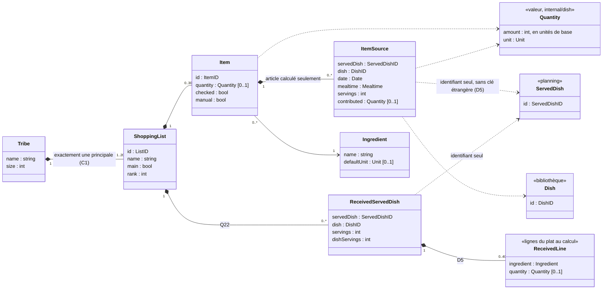
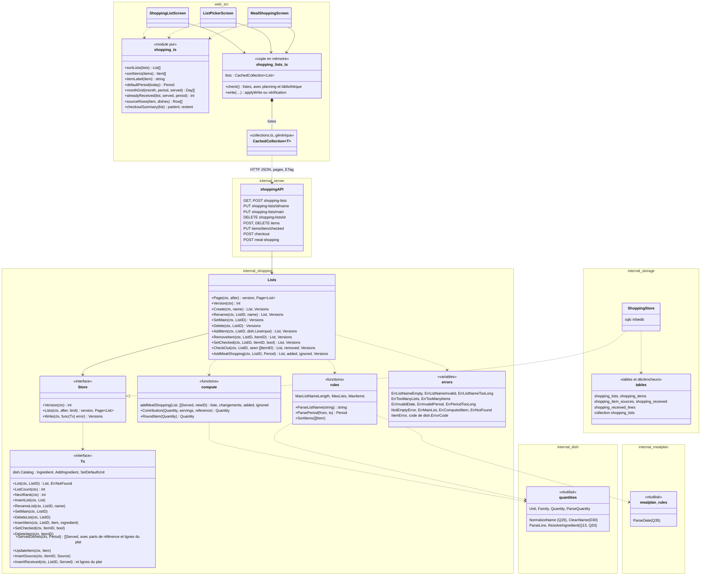
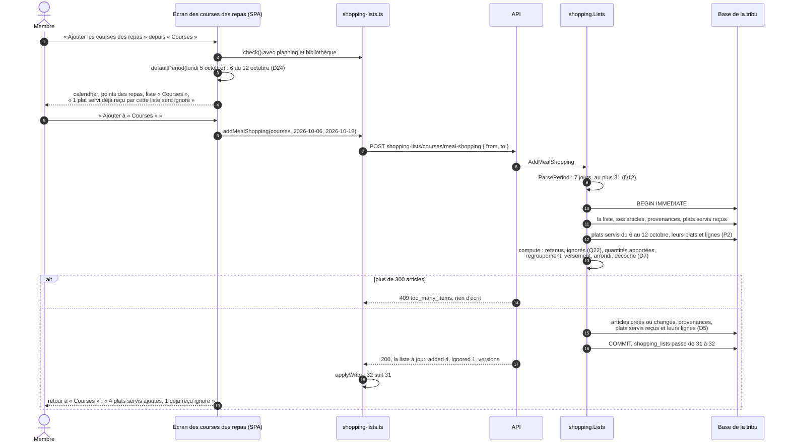
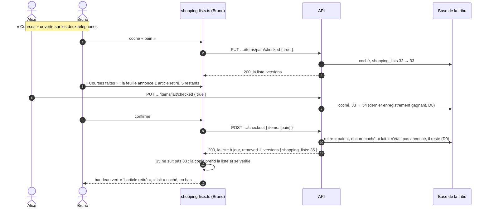
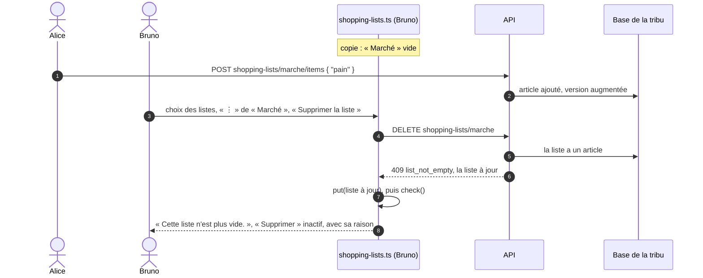

# Conception : listes de courses

- **Mise à jour** : 2026-11-07 (lot D)
- **Statut** : retenu avec le plan [`courses`](../plans/2026-11-06-listes-de-courses.md), accordé aux specs, au glossaire et au design par son lot A (2026-11-07) ; noms du serveur des listes et des articles fixés par le lot B, ceux du calcul par le lot C ; à tenir à jour par les plans qui touchent ce domaine (`courses-suite`, hors-ligne)
- **Stories** : C1 à C6, C11, C12 ; P2 pour le calcul ; T1 et ENF-02 pour les listes. C7 à C10 sont prévues par le modèle, pas réalisées.

Ce document décrit la conception retenue pour les listes de courses : modèle, calcul, découpage du code, API, échanges. Il s'appuie sur la bibliothèque de plats ([`bibliotheque-de-plats.md`](bibliotheque-de-plats.md)), dont il réutilise les quantités, les unités, le référentiel et la copie des collections, et sur le planning ([`planning-des-repas.md`](planning-des-repas.md)), dont il lit les plats servis. Les règles fonctionnelles sont dans `docs/specs/fonctionnalites.md` (C1 à C12, « Ajout des courses d'une période », « Règle de calcul », « Unités, conversions et arrondis », Q10 à Q18, Q22 à Q24, Q36 à Q40), les décisions dans les ADR (0003, 0027, 0029) et dans le plan (D1 à D24).

Noms anglais du code selon `docs/specs/glossaire.md` : liste de courses (*shopping list*), liste principale (*main list*), article (*item*), article calculé (*computed item*), article ajouté (*manual item*), article sans quantité (*unquantified item*), provenance (*item source*), quantité apportée (*contributed quantity*), plats servis reçus (*received served dishes*), ajouter les courses des repas (*add meal shopping*), période (*period*), déclarer les courses faites (*check out*), choix des listes (*list picker*), destination des courses (*target list*), copie des listes (*cached shopping lists*).

## Modèle du domaine

- **ShoppingList** : identifiant aléatoire (D10) ; nom de 40 caractères au plus, non unique (Q17, D12) ; **rang** de création, qui ordonne les listes après la principale (C2) ; **principale** pour exactement une liste de la tribu (Q23), garantie par un index unique partiel. La liste « Courses », principale, est créée par la migration `0009` dans toute base de tribu (D14). 20 listes au plus (D12).
- **Item** : identifiant aléatoire ; un ingrédient du référentiel ; une quantité facultative, en unités de base avec son unité d'affichage (ADR 0003, point 7) ; coché ou non ; **ajouté** (saisi à la main, sans provenance) ou **calculé** (au moins une provenance). Une liste a au plus un article calculé par ingrédient et famille d'unités, plus au plus un article calculé sans quantité par ingrédient (Q24, D3) ; les articles ajoutés ne sont jamais fusionnés (Q13). 300 articles au plus par liste (D12).
- **ItemSource** (provenance) : ce qu'un plat servi a apporté à un article calculé, **au moment du calcul** : le plat servi, le plat, la date, le moment, les parts et la quantité apportée (absente pour un ingrédient sans quantité). Pas de clé étrangère vers `served_dishes` : un plat servi retiré du planning laisse sa provenance lisible (C5) jusqu'au recalcul (D5).
- **ReceivedServedDish** : les plats servis dont la liste a reçu les courses (Q22), avec le plat, les parts servies, les **parts de référence du plat** (`dishServings`) et les **lignes du plat au moment du calcul** (`ReceivedLine`), y compris ceux sans ingrédient (« Restes ») et ceux dont les articles sont partis par les courses faites ; jamais retirés en V1, sans clé étrangère. C'est ce qui permettra à `courses-suite` de dire qu'une liste est périmée (C8) : un plat servi reçu qui a encore une provenance dans la liste a changé si le plat servi a été retiré, si ses parts ont changé, si les parts de référence du plat ont changé (la quantité apportée en dépend), ou si les lignes actuelles du plat diffèrent des lignes gardées ; les lignes gardées distinguent une ligne ajoutée au plat d'une ligne dont l'article est parti, que le recalcul ne recrée pas (D5). Le nom du plat n'y est pas : un renommage ne rend pas une liste périmée. Ces données restent dans le serveur ; l'API ne donne que les identifiants (`received`).
- **Ingredient**, **Quantity**, **Dish**, **ServedDish** : inchangés. Un article ajouté peut créer un ingrédient (Q13) et fixer son unité par défaut (Q20).

## Calcul des courses d'une période

Le calcul est **pur** (`internal/shopping`, D6) : il reçoit la liste, les plats servis de la période, les plats et leurs lignes, et rend la liste nouvelle et ses comptes. Toutes les quantités sont des entiers en unités de base : milligramme pour les masses, millilitre pour les volumes, millième de pièce, de cuillère à soupe, de cuillère à café, de pincée.

1. **Plats servis retenus** : ceux de la période (bornes incluses) qui ne sont pas déjà reçus par la liste ; les autres sont comptés comme ignorés (Q22). Tous les retenus deviennent des plats servis reçus, même sans ingrédient, avec leurs parts, les parts de référence du plat et ses lignes, lues dans la transaction (D5).
2. **Quantité apportée** par chaque ligne de chaque plat retenu : `quantité du plat × parts servies ÷ parts de référence`, arrondie à l'unité de base supérieure (D7). Une ligne sans quantité apporte une provenance sans quantité (D3).
3. **Regroupement** par ingrédient et famille d'unités (masse, volume, pièce, cuillère à soupe, cuillère à café, pincée), plus un groupe « sans quantité » par ingrédient.
4. **Versement** dans la liste : un groupe dont l'article calculé existe déjà (même ingrédient, même famille, ou tous deux sans quantité) s'y ajoute et lui donne de nouvelles provenances ; sinon un article calculé nouveau est créé. Les articles ajoutés ne sont pas touchés.
5. **Arrondi de l'article**, après l'addition des quantités apportées de toutes ses provenances, anciennes et nouvelles : pièces, cuillères et pincées à l'entier supérieur (Q4), masses au gramme supérieur (Q37, D7) ; les volumes sont déjà en millilitres entiers.
6. **Coche** : un article coché dont la quantité arrondie augmente est décoché ; un article sans quantité garde sa coche (Q36, D3).
7. **Limite** : si la liste dépasse 300 articles, rien n'est écrit (D12).

Exemple de la spec : « Chili con carne », défini pour 4 parts avec 500 g de bœuf haché et 1 oignon, servi pour 3 parts le mardi soir et pour 4 parts le jeudi midi. Bœuf : 375 000 mg et 500 000 mg apportés, 875 000 mg, affichés « 875 g ». Oignon : 750 et 1 000 millièmes apportés, 1 750, arrondis à 2 000 : « 2 pièces » ; le dépliage montre « 0,75 pièce » et « 1 pièce ».

L'**unité d'affichage** d'un article calculé est la plus grande unité de sa famille qui donne au moins 1 (spec) : 1 500 000 mg en kg (« 1,5 kg »), 750 ml en cl (« 75 cl »). Elle est choisie par le navigateur (`shopping.ts`) à partir de la quantité renvoyée par l'API dans la plus petite unité de la famille (ci-dessous), avec les règles d'affichage des quantités du design.

## Découpage du code

- **`internal/shopping`** (nouveau paquet, ADR 0008) : règles pures (nom, période, limites), calcul pur (`compute`) et `Lists`, qui écrit derrière une interface `Store`, sans HTTP ni SQL (ADR 0002). Il dépend de `internal/dish` pour les unités, les familles et leur facteur (`Unit.Factor`), les quantités, le nom normalisé, la règle des noms (`CleanName`), celle d'une ligne saisie (`ParseLine`) et la résolution d'un ingrédient dans le référentiel (`ResolveIngredient`, sur l'interface `dish.Catalog`), communes aux plats et aux articles ajoutés ; de `internal/mealplan` pour la seule règle des dates (`ParseDate`), le `Tx` lui rendant les plats servis de la période. Le `Tx` écrit par opérations ciblées (une liste, un article, une coche, une provenance, un plat servi reçu), lues puis vérifiées par `Lists` ; le calcul pur rend la liste après, les articles créés ou changés avec les provenances qu'ils gagnent, et les plats servis reçus, que `Lists` écrit. Table de cas des quantités apportées et des arrondis : `internal/shopping/testdata/meal-shopping.json`, lue par `go test` et par `shopping.ts` (lot E).
- **`internal/storage`** : migration `0009` (cinq tables, leurs déclencheurs, la liste « Courses », collection `shopping_lists` dans `storage.Collections`), requêtes sqlc, adaptateur `ShoppingStore`. Une écriture augmente la version d'une unité exactement (`writeCollections`, conception de la bibliothèque), qu'elle touche une ou cent lignes. Un article ajouté qui crée un ingrédient augmente aussi `ingredients`. Supprimer une liste supprime ses plats servis reçus et leurs lignes ; retirer un article, ses provenances.
- **`internal/collection`** : inchangé ; `GET shopping-lists` passe par `Serve`.
- **`internal/server`** : routes minces sous `/tribes/<slug>/api/`, derrière la session.
- **`web/src`** : `shopping.ts`, module pur testé par `node:test`, dont l'ordre des articles partage sa table de cas avec `SortItems` (`internal/shopping/testdata/sort-items.json`, revue de la PR #98, point 3) ; `shopping-lists.ts`, copie des listes sur `CachedCollection`, vérifiée avec `planning.ts` et `library.ts` sur l'écran des courses des repas et pour le dépliage (lot E) ; écrans `shopping-list-screen.ts`, `list-picker-screen.ts` (lot D), `meal-shopping-screen.ts` (lot E) ; la combobox d'ingrédient de l'écran d'un plat devient un contrôleur Lit, `ingredient-combobox.ts`, partagé par l'écran d'un plat et le formulaire d'un article ajouté ; `warningBanner` est repris.

## API

| Route | Corps | Réponses |
| --- | --- | --- |
| `GET shopping-lists?after=…` | | 200 : `{ items: [List], next? }`, 20 listes au plus par page, dans l'ordre des identifiants (D4) ; `ETag: "shopping_lists-<version>"`, `304`, `412` (ADR 0029) |
| `POST shopping-lists` | `{ name }` | 201 : `{ list, versions }` ; 400 : `list_name_empty`, `list_name_invalid`, `list_name_too_long` ; 409 `too_many_lists` |
| `PUT shopping-lists/{id}/name` | `{ name }` | 200 : `{ list, versions }` ; 400 comme ci-dessus ; 404 |
| `PUT shopping-lists/main` | `{ list }` | 200 : `{ versions }`, vide pour la liste déjà principale ; 404 |
| `DELETE shopping-lists/{id}` | | 200 : `{ versions }` ; 409 `{ error: "list_not_empty", list }`, la liste à jour ; 409 `main_list` ; 404 |
| `POST shopping-lists/{id}/items` | `{ ingredient, quantity?, unit? }` | 201 : `{ list, versions }` ; 400 : les codes d'une ligne de plat, `ingredient_name_required`, `ingredient_name_invalid`, `ingredient_name_too_long`, `unit_required`, `invalid_unit`, `invalid_quantity`, `quantity_too_precise` (même règle, `dish.ParseLine`, mêmes messages) ; 409 `too_many_items` ; 404 |
| `DELETE shopping-lists/{id}/items/{item}` | | 200 : `{ list, versions }` ; 409 `computed_item` ; 404, liste supprimée entre-temps ou article inconnu (l'écran le traite comme un retrait fait, D11) |
| `PUT shopping-lists/{id}/items/{item}/checked` | `{ checked }` | 200 : `{ list, versions }` ; 400 `bad_request` sans `checked` ; 404 |
| `POST shopping-lists/{id}/checkout` | `{ items: [ItemID] }`, ceux vus cochés | 200 : `{ list, removed, versions }` (D9) ; 404 |
| `POST shopping-lists/{id}/meal-shopping` | `{ from, to }` | 200 : `{ list, added, ignored, versions }`, `versions` vide sans plat servi ajouté ; 400 `invalid_date`, `invalid_period`, `period_too_long` ; 409 `too_many_items` ; 404 |

Une liste (`List`) : `{ id, name, main, rank, items: [Item], received: [ServedDishID] }`, ses articles dans l'ordre de Q40 (`SortItems` : non cochés puis cochés, nom normalisé, avec quantité avant sans quantité, calculé avant ajouté, puis identifiant pour un ordre stable) ; un article (`Item`) : `{ id, ingredient, quantity?, unit?, checked, manual, sources: [{ servedDish, dish, date, mealtime, servings, quantity?, unit? }] }`.

**Un seul format de quantité, en lecture comme en écriture**, celui des lignes des plats (`lineResponse`, `internal/server/api_dishes.go`) et de `POST …/items` : `quantity`, le texte de `Quantity.Text()` (point décimal, sans zéro inutile, relu par `ParseQuantity`), et `unit`, le code d'une unité de la liste fermée (revue #92, point 2). Un article ajouté garde l'unité saisie. Un article calculé et ses provenances sont exprimés dans la **plus petite unité de leur famille** : `g`, `ml`, `piece`, `tablespoon`, `teaspoon`, `pinch` (« 875 » `g`, « 0.75 » `piece`) ; `shopping.ts` en tire l'unité d'affichage. Aucune quantité en unités de base (milligrammes, millièmes) ne sort du serveur : elles restent dans la base et le calcul. Le nom de l'ingrédient est donné en clair, comme dans les lignes d'un plat (le référentiel n'a pas d'identifiant public, `bibliotheque`, D10).

Toutes ces routes répondent 401 `no_session` sans session et gardent `Cache-Control: no-store`. Corps limité à 4 Kio (`maxBodyBytes`), sauf celui de `checkout`, limité à 16 Kio (`maxCheckoutBodyBytes`, comme `maxDishBodyBytes` pour un plat) : il porte au plus 300 identifiants de 32 caractères hexadécimaux, soit environ 10,5 Kio en JSON (revue #92, point 1).

- **`404` identique** pour une liste ou un article inconnu, supprimé entre-temps ou d'une autre tribu (ENF-02).
- **Écritures sur une liste** : la réponse porte la liste entière à jour, que la copie prend ; un `409 list_not_empty` aussi.
- **`versions`** : celles des seules collections que l'écriture a changées (`shopping_lists`, et `ingredients` quand un article ajouté crée son ingrédient) ; une écriture qui ne change rien les laisse vides (lot D ; revue de la PR #98, point 2).
- **`from`, `to`** : `AAAA-MM-JJ`, dates réelles de 2000-01-01 à 2099-12-31 (Q35, `invalid_date` sinon, comme le planning) ; `to` au plus tôt `from` (`invalid_period`), 31 jours au plus (`period_too_long`, D12). Le serveur ne connaît pas « aujourd'hui » : la période par défaut est calculée par l'appareil (D24).

## Données dans le navigateur

Les listes vivent dans une **copie en mémoire** (`web/src/shopping-lists.ts`), une `CachedCollection` de la collection `shopping_lists`, comme les plats et le planning (ADR 0029, point 4). Elle est vérifiée à chaque visite de l'onglet Courses et à chaque retour au premier plan ; avec la copie du planning et celle de la bibliothèque sur l'écran des courses des repas (jours ayant des repas, plats servis déjà reçus) et pour le dépliage (nom et couleur des plats). Après une écriture, la copie prend la liste renvoyée et la version, ou se vérifie si un autre membre a écrit entre-temps ; après un `404`, elle retire la liste ou se vérifie. `PUT shopping-lists/main` ne renvoie que les versions : la copie inverse elle-même les deux drapeaux `main` si la version suit la sienne, sinon elle se vérifie. Rien n'est écrit sur l'appareil (D2) : la copie disparaît au rechargement, à la déconnexion et sur un 401.

Réalisation (lot D) : une coche est montrée aussitôt dans la copie, triée de nouveau, puis remplacée par la liste renvoyée ; sans réseau, l'article revient à son état. Un refus `409` (`list_not_empty`, `main_list`, `too_many_lists`, `too_many_items`) dit que la copie est en retard : elle prend la liste renvoyée s'il y en a une, puis se vérifie. Un `404` fait vérifier la copie, qui dit ensuite si la liste a été supprimée entre-temps (l'écran ouvre la liste principale avec son bandeau, D11) ou seulement l'article (aucun message, D8). Une écriture dont les `versions` portent `ingredients` différente de celle de la copie du référentiel fait vérifier celle-ci : l'élément de liste ne porte pas l'unité par défaut d'un ingrédient créé (Q20). La copie des listes est vérifiée au retour au premier plan quand l'onglet Courses est affiché.

Réalisation (lot E) : la copie des listes se vérifie avec celle de la bibliothèque, pour le dépliage ; l'écran des courses des repas vérifie aussi la copie du planning, à son ouverture et au retour au premier plan. Après un refus ou un `404`, seule la copie des listes se vérifie. `POST …/meal-shopping` passe par la même lecture de réponse que les autres écritures, qui en garde `added` et `ignored`.

Ce que l'écran montre de ces échanges (bandeaux, feuilles, messages, « Réseau nécessaire ») est décrit dans `docs/design/README.md`, « Listes de courses » et « Messages des listes de courses » (lot A). `shopping.ts` trie de nouveau les articles après une coche locale, avec la même règle que `SortItems`.

## Échanges

### Ajouter les courses des repas d'une période

La transaction immédiate (ADR 0003) sérialise deux ajouts simultanés : le second voit les plats servis reçus par le premier et les ignore (Q22, D6).

### Cocher, puis déclarer les courses faites à deux

### Supprimer une liste devenue non vide entre-temps

## Preuves

- **Contre l'API** (godog) : listes (principale à la naissance, changement de principale, création, nom, renommage, suppression et ses refus), articles ajoutés (quantité facultative, référentiel enrichi, retrait, deux articles du même ingrédient), ordre des articles, coche, courses faites, toutes les règles de calcul de C4 (dont la période et ses bornes, les masses au gramme) et le décompte de C5, P2, ingrédient sans quantité, limites, écritures croisées, T1, ENF-02 (listes et articles) ; tableau « Scénarios couverts » du plan.
- **Dans le navigateur** (`@ui`, ADR 0028), horloge de Playwright au lundi 5 octobre 2026 : l'onglet Courses ouvre la liste principale (C1), ordre des listes (C2), période et liste par défaut, date de fin avant le début (C4), dépliage d'un article, article ajouté non dépliable (C5), sous Chromium et WebKit.
- **Tests unitaires** : règles et calcul de `internal/shopping` (`go test`, table de cas `internal/shopping/testdata/` tirée des exemples de la spec) ; `shopping.ts` (`node:test`) : ordres, libellés et unités d'affichage, période par défaut, grille d'un mois, plats servis déjà reçus, lignes dépliées, résumé des courses faites.

## Ce que ce document ne couvre pas encore

- **Le recalcul d'une liste périmée** (C8) et **la sélection d'articles** (C9, C10) : `courses-suite`. Le modèle les prévoit : provenances avec ce qu'elles ont apporté, plats servis reçus avec leurs parts, les parts de référence du plat et ses lignes au moment du calcul (D5).
- **Le hors-ligne** des listes (C7, Q16, Q18) : stockage sur l'appareil, file des coches et des ajouts, rejeu au retour du réseau ; plan hors-ligne, qui s'ajoutera à la copie des collections sans la remplacer (ADR 0029, conséquences). Ce plan reprendra aussi un défaut d'affichage noté à la revue de la PR #100 : pendant qu'une coche attend sa réponse, la réponse à une autre écriture remplace la liste entière, et l'article en attente s'affiche un instant dans son état d'avant ; la file des coches devra garder les coches en attente par-dessus les listes reçues.
- **Le delta d'une collection**, si les listes deviennent longues à recharger (plan, questions ouvertes).
