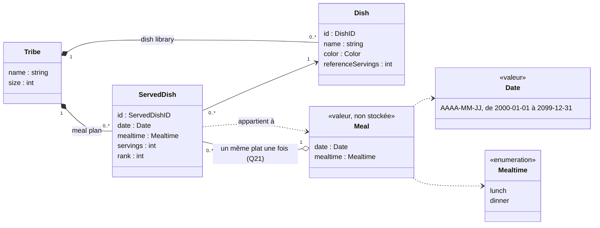
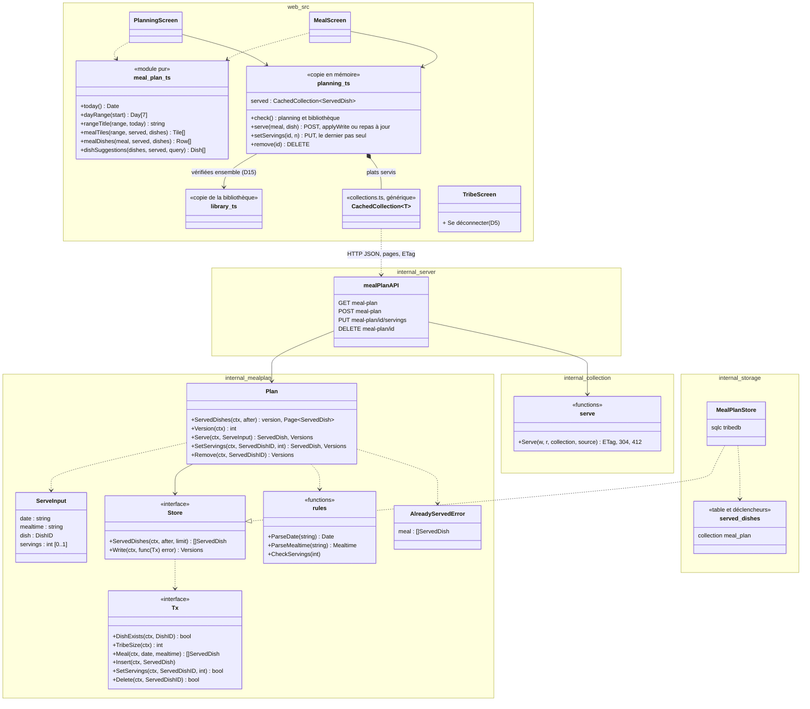
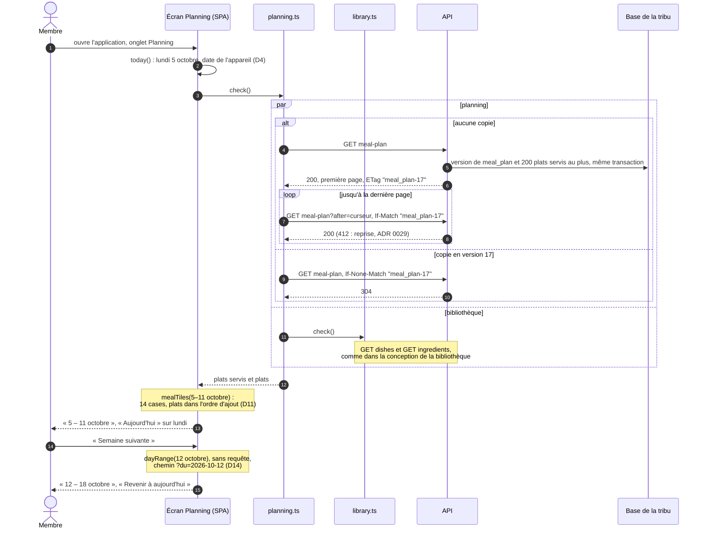
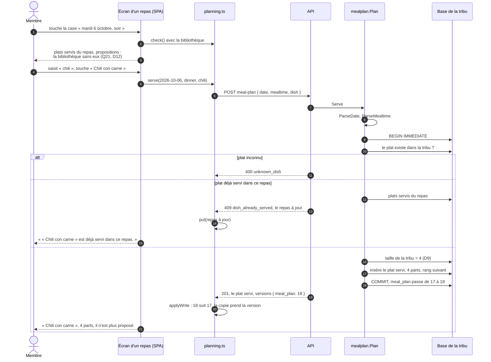
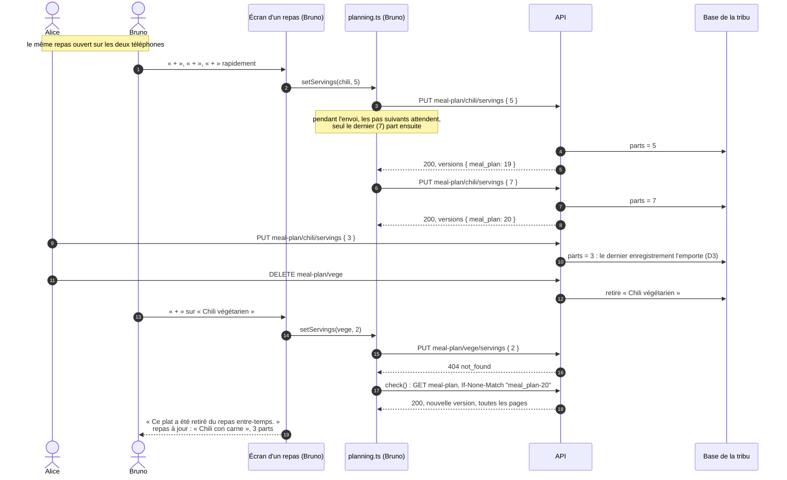
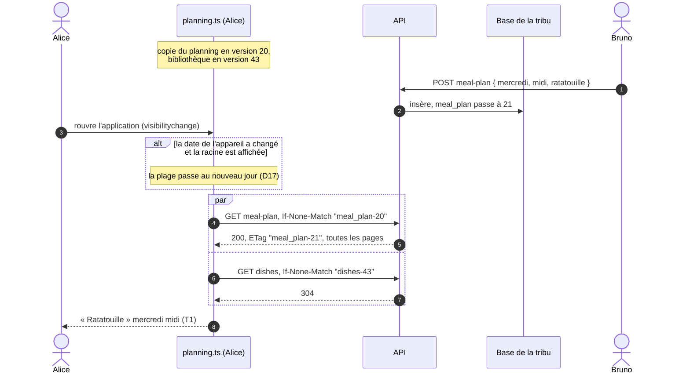

# Conception : planning des repas

- **Mise à jour** : 2026-11-05
- **Statut** : retenu avec le plan [`planning`](../plans/2026-11-05-planning-des-repas.md) ; accordé aux specs, au glossaire et au design par le lot A (2026-11-05) ; noms du code à fixer par les lots B à D ; à tenir à jour par les plans qui touchent ce domaine (listes de courses, hors-ligne)
- **Stories** : R1 à R5 ; T1 et T3 pour le planning ; ENF-02 pour le planning

Ce document décrit la conception retenue pour le planning des repas : modèle, découpage du code, API, échanges. Il s'appuie sur la bibliothèque de plats ([`bibliotheque-de-plats.md`](bibliotheque-de-plats.md)), dont il réutilise la taille de la tribu, la copie des collections et la recherche, sans les répéter. Les règles fonctionnelles sont dans `docs/specs/fonctionnalites.md` (R1 à R5, Q1, Q2, Q5, Q8, Q21, Q32 à Q35), les décisions dans les ADR (0027, 0029) et dans le plan (D1 à D20).

Noms anglais du code selon `docs/specs/glossaire.md` : planning (*meal plan*), repas (*meal*), moment (*mealtime* : *lunch*, *dinner*), plat servi (*served dish*), parts (*servings*), rang (*rank*), ajouter un plat à un repas (*serve a dish*), retirer (*remove*), jour (*day*), aujourd'hui (*today*), plage de jours (*day range*), case de repas (*meal tile*), proposition de plat (*dish suggestion*), copie du planning (*cached meal plan*).

## Modèle du domaine

- **Meal** : une case du planning, une date et un moment (Q1). Il n'est **pas stocké** : un repas existe dès qu'on le désigne, vide tant qu'aucun plat n'y est servi. Rien à créer, rien à supprimer.
- **ServedDish** : identifiant aléatoire (D10) ; date, moment et plat, uniques ensemble (Q21) ; **parts** de 1 à 50 (Q35), la taille de la tribu au moment de l'ajout (Q8, T3, D9) ; **rang** d'ajout, qui ordonne les plats d'un repas (D11, Q35). Ni auteur ni date de modification (D18), ni révision (D3). Un plat retiré puis ajouté de nouveau est un **nouveau** plat servi (D2, Q32).
- **Dish** : inchangé. Un plat n'est jamais supprimé (Q5b) : un plat servi désigne toujours un plat existant. Les parts de référence d'un plat ne fixent pas celles d'un plat servi (Q8) ; elles sont affichées dans le détail d'un repas (« Défini pour 4 parts ») et serviront au calcul des courses.
- **Date** : sans fuseau ni heure. Le serveur ne connaît pas « aujourd'hui » ; c'est la date de l'appareil qui fixe la plage affichée (D4, Q34). Les repas passés sont modifiables comme les autres (R5, Q2).
- **Tribe** : sa taille sert désormais aussi aux plats servis ajoutés ; ceux déjà placés ne changent pas (T3).

## Découpage du code

- **`internal/mealplan`** (nouveau paquet, ADR 0008 : un paquet par domaine) : règles pures (dates, moments, parts) et `Plan`, qui ajoute, règle et retire derrière une interface `Store`, sans HTTP ni SQL (ADR 0002). Il ne dépend pas de `internal/dish` pour ses règles : il ne demande au `Tx` que si un plat existe ; la borne des parts est la même constante que pour un plat.
- **`internal/storage`** : migration `0008` (table `served_dishes`, ses déclencheurs, collection `meal_plan` dans `storage.Collections`), requêtes sqlc, adaptateur `MealPlanStore`, écritures par `writeCollections` (une écriture augmente la version d'une unité exactement, conception de la bibliothèque).
- **`internal/collection`** : inchangé ; `GET meal-plan` passe par `Serve`.
- **`internal/server`** : routes minces sous `/tribes/<slug>/api/`, derrière la session.
- **`web/src`** : `meal-plan.ts`, module pur testé par `node:test` (dates de l'appareil, plages, cases, propositions) ; `planning.ts`, copie du planning sur `CachedCollection`, vérifiée avec `library.ts` ; écrans `planning-screen.ts` (remplace `home-screen.ts`) et `meal-screen.ts` ; le stepper de parts (`mt-stepper`) et `searchDishes` (`dishes.ts`) sont repris tels quels.

Noms à fixer aux lots B à D, et à reporter ici.

## API

| Route | Corps | Réponses |
| --- | --- | --- |
| `GET meal-plan?after=…` | | 200 : `{ items: [{ id, date, mealtime, dish, servings, rank }], next? }`, une page de 200 plats servis au plus, dans l'ordre des identifiants (D1) ; `ETag: "meal_plan-<version>"`, `304`, `412` comme toute collection (ADR 0029) |
| `POST meal-plan` | `{ date, mealtime, dish, servings? }` | 201 : `{ servedDish, versions }` ; 400 : `invalid_date`, `invalid_mealtime`, `invalid_servings`, `unknown_dish` ; 409 : `{ error: "dish_already_served", meal: [ … ] }`, les plats servis du repas à jour (Q21, D3) |
| `PUT meal-plan/{id}/servings` | `{ servings }` | 200 : `{ servedDish, versions }` ; 400 `invalid_servings` ; 404 `not_found`, plat servi retiré entre-temps, inconnu ou d'une autre tribu (D3, ENF-02) |
| `DELETE meal-plan/{id}` | | 200 : `{ versions }` ; 404 `not_found` comme ci-dessus (D19) |

`DELETE` rend `200 { versions }` plutôt qu'un `204` sans corps : la copie prend la version comme après toute écriture (ADR 0029, point 4).

Toutes ces routes répondent 401 `no_session` sans session et gardent `Cache-Control: no-store`. Corps limité à 4 Kio.

- **`date`** : `AAAA-MM-JJ`, une date réelle de 2000-01-01 à 2099-12-31 (D4) ; **`mealtime`** : `lunch` ou `dinner` ; **`dish`** : l'identifiant d'un plat de la bibliothèque de la tribu, sinon `unknown_dish`, qu'il soit inconnu ou d'une autre tribu (ENF-02).
- **`servings`** : de 1 à 50 ; absentes de `POST`, la taille de la tribu, lue dans la transaction de l'ajout (D9) ; l'écran ne les envoie pas.
- **`rank`** : rang d'ajout dans la tribu, croissant ; les plats d'un repas se trient par rang (D11).
- **Le plat servi ne porte pas le plat** : seulement son identifiant ; nom, couleur et parts de référence viennent de la copie de la bibliothèque. Une modification d'un plat ne change donc pas la version de `meal_plan`.
- **Plat servi déjà présent** : l'index unique (date, moment, plat) refuse le doublon, même entre deux ajouts simultanés ; la transaction immédiate rend le repas à jour avec le refus.

## Données dans le navigateur

Le planning vit dans une **copie en mémoire** (`web/src/planning.ts`), une `CachedCollection` de la collection `meal_plan`, comme les plats et le référentiel (ADR 0029, point 4). Elle est vérifiée **avec la bibliothèque** à chaque visite du Planning ou d'un repas et à chaque retour au premier plan (D15) : les cases montrent le nom et la couleur des plats, que seule la bibliothèque connaît. Après une écriture, la copie prend le plat servi renvoyé (ou retire celui qui a été retiré) et la version, ou se vérifie aussitôt si un autre membre a écrit entre-temps ; après un `409`, elle prend les plats servis du repas à jour ; après un `404`, elle se vérifie. Rien n'est écrit sur l'appareil : la copie disparaît au rechargement, à la déconnexion et sur un 401.

La plage affichée, ses voisines et les cases se calculent dans le navigateur (`meal-plan.ts`), sans requête : changer de semaine ne coûte rien.

Ce que l'écran montre de ces échanges (titres des plages, propositions, bandeaux d'avertissement après un `409` ou un `404`, « Réseau nécessaire ») est décrit dans `docs/design/README.md`, « Planning et détail d'un repas ».

## Échanges

### Ouvrir le Planning et changer de semaine

### Ajouter un plat à un repas

L'ajout se fait dans une transaction immédiate (ADR 0003) : deux membres qui ajoutent en même temps le même plat au même repas ne font pas de doublon ; le second reçoit le repas à jour (D3).

### Régler les parts, et un plat retiré entre-temps

Les parts ne sont pas protégées par une révision (D3) : une modification croisée de parts n'est pas signalée, la dernière gagne, et chacun voit l'état final à sa vérification suivante. Un retrait, lui, ne se perd pas en silence.

### Revenir sur l'application après un ajout d'un autre membre

Sans changement, le retour coûte trois `304` : planning, plats et référentiel, que la copie de la bibliothèque vérifie ensemble (le diagramme ne montre pas le référentiel).

## Preuves

- **Contre l'API** (godog) : ajout, plusieurs plats dans un repas, refus d'un doublon, parts, retrait, plat retiré puis ajouté de nouveau, ordre d'ajout, repas passés, limites (parts de 1 à 50, repas de 2000 à 2099), plat inconnu, écritures croisées (ajout du même plat, dernier réglage des parts, parts d'un plat retiré), planning partagé (T1), taille de la tribu (T3), compartimentage (ENF-02) ; tableau « Scénarios couverts » du plan.
- **Dans le navigateur** (`@ui`, ADR 0028), horloge de Playwright au lundi 5 octobre 2026 : 7 jours à partir d'aujourd'hui (R1), semaines suivante et précédente (R5), plat déjà servi non proposé (R2), sous Chromium et WebKit.
- **Tests unitaires** : règles de `internal/mealplan` (`go test`), dont les dates réelles (un 30 février est refusé) ; `meal-plan.ts` (`node:test`) : plages, titres (à cheval sur deux mois, deux années, autre année), cases, propositions, changement de jour.

## Ce que ce document ne couvre pas encore

- Les listes de courses : ce qu'une liste retient d'un plat servi pour savoir qu'il a changé (C8) et le calcul des quantités à partir des parts (règle de calcul) ; l'identité d'un plat servi est fixée (D2).
- Le delta d'une collection, si le planning devient long à recharger (plan, questions ouvertes).
- Le hors-ligne : stockage du planning sur l'appareil, consultation hors ligne (ENF-01).
