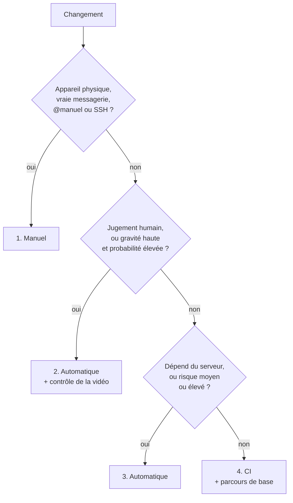

# Recette

Ce qu'on vérifie avant une release, et comment on décide de la façon de le vérifier (ADR 0032). Mis en place par le plan `recette-auto`, lot A, le 2026-11-15.

Toute recette commence par une **analyse des changements et des risques**, qui produit le **plan de recette** de la version, `docs/recettes/vX.Y.Z.md` (gabarit : [`recettes/_template.md`](recettes/_template.md)). Le plan de recette dit, pour chaque changement, s'il est prouvé par la CI, automatiquement sur la recette, avec ou sans contrôle de la vidéo, ou à la main. Il reçoit ensuite les résultats : c'est la seule trace de la recette, les vidéos étant supprimées à la fin.

## Ce que la recette ajoute à la CI

La CI prouve les règles contre l'API (godog), l'interface sur un serveur de test local, sur une API simulée pour les états des écrans, avec les e-mails écrits dans un fichier, et tous les formats sur la PR de release (`make e2e-formats`). Elle ne voit pas :

- **le serveur** : systemd, Caddy, TLS, en-têtes et cookies `__Host-`, fichiers du front à empreinte servis avec `immutable`, migration appliquée à des données accumulées, envoi SMTP par le MX Plan ;
- **l'appareil physique** : toucher, clavier virtuel, rotation de l'appareil, application installée, fluidité ressentie ;
- **les vraies messageries** : arrivée du code chez Gmail, Outlook, iCloud, hors des indésirables ;
- **le regard** : conformité à la maquette, lisibilité, enchaînement d'un parcours.

La recette ne refait pas ce que la CI prouve ; elle cherche ce que la CI ne peut pas voir.

## Rôles

- **La session qui prépare la PR de release** (`RELEASING.md`) propose l'analyse : elle écrit `docs/recettes/vX.Y.Z.md` dans la PR de release, avant le déploiement en recette.
- **Le développeur** la valide ou la corrige avant la séance. Il peut toujours faire passer un point dans une voie plus manuelle ; l'inverse se discute.
- **Claude Code dans le Dev Container** écrit les parcours ciblés que l'analyse demande, lance `make recette-auto` et reporte les résultats dans le plan de recette.

## 1. Inventaire

Une entrée par ligne de la section `## Non publié` de `CHANGELOG.md` (une ligne par PR). On y ajoute ce que les lignes ne disent pas, d'après le dépôt :

```sh
git diff --name-only --diff-filter=A vA.B.C..HEAD -- internal/storage/migrations/   # migrations
git diff --stat vA.B.C..HEAD -- deploy/                                             # serveur
git diff vA.B.C..HEAD -- go.mod web/package.json .nvmrc                            # dépendances, Go, Node
```

Une ligne qui ne touche que la documentation, un plan ou les tests est une entrée comme les autres : elle tombe d'elle-même dans la voie CI. Une ligne qui regroupe plusieurs changements de nature différente (une story et un point reporté, par exemple) se scinde en autant d'entrées.

## 2. Trois questions par changement

**Gravité** si le défaut passe en production :

| Gravité | Ce que ça veut dire | Exemples |
| --- | --- | --- |
| haute | données perdues ou faussées ; une tribu voit ou modifie une autre ; connexion impossible ; sécurité | migration, recalcul des courses, compartimentage, connexion |
| moyenne | une fonction inutilisable, contournement possible | déplacement d'articles impossible, semainier qui ne défile pas |
| faible | gêne, affichage | libellé, alignement, couleur |

**Probabilité qu'un défaut ait échappé à la CI** :

| Probabilité | Signes |
| --- | --- |
| élevée | code nouveau sans scénario qui passe ; calcul ; migration ; comportement que seul un navigateur réel exerce ; scénarios encore dans `pending.txt` ; écran prouvé seulement sur l'API simulée (`api-mock.ts`) |
| moyenne | code modifié, couvert par des scénarios, mais dans un seul format, ou par des tests d'écran seulement |
| faible | scénarios godog ou `@ui` qui passent dans tous les formats (`make e2e-formats`) ; changement mécanique (montée de version sans changement d'API, test rendu stable) |

**Dépendance à l'environnement réel**, en deux familles :

- **le serveur** : migration sur des données existantes ; Caddy, TLS, en-têtes, cookies ; envoi SMTP ; cache et empreintes du front ; systemd et provisionnement. *Un parcours automatique sur la recette le voit.*
- **l'appareil physique et les vraies messageries** : toucher (double toucher, défilement au doigt, taille des cibles), clavier virtuel, rotation de l'appareil, application installée, fluidité ressentie ; arrivée du code dans une messagerie. *Aucun navigateur émulé ne le voit, filmé ou non.*

## 3. Voie de preuve

Quatre règles, **appliquées dans l'ordre** ; la première qui s'applique donne la voie. Un changement peut relever de plusieurs règles par des aspects différents : il a alors plusieurs entrées dans le plan de recette, une par aspect.

1. **Manuel** :
   - sur un vrai appareil, ce qui dépend de l'appareil physique ;
   - dans les vraies messageries, la réception du code ;
   - les scénarios `@manuel` (liste dans `RELEASING.md`) ;
   - sur le serveur, ce qui demande SSH ou `sudo` et que le Dev Container ne fait pas : retour arrière et restauration après une migration, provisionnement relancé, `tribe-menus-check report`.

   La vidéo d'un navigateur émulé n'en prouve rien.
2. **Automatique avec contrôle de la vidéo** :
   - ce qui demande un jugement humain sans demander d'appareil : conformité à la maquette, lisibilité, messages et bandeaux, mise en page dans un format, enchaînement d'un parcours ;
   - tout changement de **gravité haute et de probabilité élevée** qui ne relève pas de la règle 1, même quand des vérifications du parcours l'établissent : on regarde aussi.

   Le parcours joue et vérifie ce qui s'assert ; le développeur regarde ensuite les points de contrôle désignés (section 4).
3. **Automatique** : dépendance au serveur, ou risque moyen ou élevé que des vérifications du parcours suffisent à établir : une quantité juste, un article déplacé, une écriture relue après rechargement, un en-tête.
4. **CI** : le reste, c'est-à-dire un risque faible (gravité et probabilité faibles ou moyennes) sans dépendance à l'environnement. Rien de plus que les parcours de base, dont la vidéo ne se regarde qu'en cas d'échec.

Dans le plan de recette, la voie s'écrit en toutes lettres, dans la colonne qui suit le changement : **manuel**, **auto + vidéo**, **auto**, **CI**.

**Un point automatisable sans parcours existant** : soit on écrit le parcours, s'il resservira (une fonction durable, un écran qui évoluera), soit on le vérifie à la main pour cette release, et le plan de recette le dit.



### Parcours de base

Joués à chaque recette, quoi qu'en dise l'analyse (ADR 0032, point 5) : connexion par le code reçu par e-mail ; chaque onglet s'ouvre, dans chaque projet ; une écriture relue par onglet (un plat, un plat servi, un article coché) ; rechargement sur la version nouvelle. Ils couvrent la non-régression générale et les entrées de la voie CI.

## 4. Points de contrôle de la vidéo

Pour chaque entrée de la voie 2, le plan de recette désigne :

- le **parcours** et le **projet** (`phone-chromium`, `phone-webkit`, `tablet-landscape-chromium`, `computer-chromium`) ;
- l'**étape**, par son nom de `test.step` dans le parcours ;
- **ce qu'il faut regarder**, avec sa référence : « le bandeau vert « Liste recalculée. » sous l'en-tête, comme sur `Doux-ListeSuite` ».

Un point de contrôle vise un instant et une chose à voir ; « regarder le parcours des listes » n'en est pas un. La page de contrôle produite par `make recette-auto` liste les points avec leur capture et un lien vers la vidéo à l'instant de l'étape. Un point bien désigné se contrôle en moins d'une minute ; le contrôle d'une release tient en un quart d'heure.

Le verdict de chaque point va dans le plan de recette : conforme, ou défaut avec l'instant de la vidéo et une description assez précise pour se passer de la vidéo, qui sera supprimée.

## 5. Déroulé d'une recette

1. **Analyse** : le plan de recette entre dans la PR de release, avant le déploiement ; le développeur le valide.
2. **Parcours ciblés** que l'analyse demande, écrits dans une PR ordinaire, fusionnée avant la PR de release ou ajoutée à elle.
3. **Déploiement en recette** de l'archive de la PR de release, par le développeur (`sudo tribe-menus-deploy --env recette --pr <numéro>`).
4. **`make recette-auto`** depuis le Dev Container, avant la séance manuelle, qui part souvent de la même IP (limitation des demandes de code, ADR 0021).
5. **Contrôle de la vidéo**, point par point, verdicts dans le plan de recette.
6. **Séance manuelle**, guidée pas à pas, réduite à la voie 1.
7. **Défauts** : chacun se corrige par une PR ordinaire ; la PR de release est mise à jour avec `main`, puis une **analyse réduite aux changements du correctif** dit ce qu'on rejoue (au moins les parcours de base et l'entrée du défaut).
8. **Fin de la recette** : plan de recette rempli, release décidée ou abandonnée ; `make recette-clean VERSION=vX.Y.Z` supprime les vidéos de la version.

Tant que l'outillage du plan `recette-auto` (lots B et C) n'est pas en place, les étapes 2, 4, 5 et 8 sont sans objet : les voies 2 et 3 se vérifient à la main, et le plan de recette le dit.

## Version corrective d'une vulnérabilité

Au niveau normal (`docs/traitement-des-vulnerabilites.md`), comme une release ordinaire. Aux niveaux accéléré et urgent, l'analyse reste dans la conversation, hors de GitHub : un plan de recette qui citerait le changement exposerait la faille. Seul un plan de recette en termes neutres entre dans le dépôt, avec la ligne de la version complétée après la production (ADR 0032, point 14).

## Exemples tirés des recettes passées

- **Double toucher sur les croix de retrait** (recette de `v0.3.0`, plan `planning`) : un plat retiré deux fois par un toucher rapide. Toucher, donc **voie 1** : seul un vrai téléphone l'aurait montré, ce qu'a fait la séance.
- **Clavier virtuel d'une tablette en paysage** (recette de `v0.5.0`, plan `grands-ecrans`) : « Enregistrer le plat » caché sous le clavier. Clavier virtuel, donc **voie 1**.
- **Semainier en étendu** (`v0.5.0`) : son rendu (sept colonnes, midi au-dessus du soir) relève de la **voie 2** ; son défilement au doigt calé sur un jour, de la **voie 1**.
- **Migration `0010`** (`v0.6.0`) : gravité haute, probabilité élevée, dépendance au serveur : **voie 2** pour l'état des listes existantes après la migration, **voie 1** pour le retour arrière avec restauration, qui se fait en SSH.
- **Deux tests du semainier rendus stables** (`v0.5.0`) : changement mécanique de tests, **voie 4**.
- **`504` au téléchargement de `v0.5.0`** par `tribe-menus-deploy` : un défaut du déploiement lui-même, vu par le développeur en déployant ; aucune voie de la recette ne le cherche, il relève d'une PR touchant `deploy/` (point reporté de la feuille de route).
